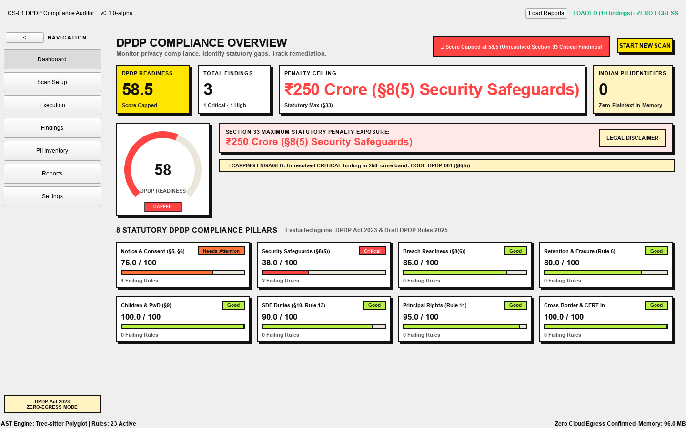
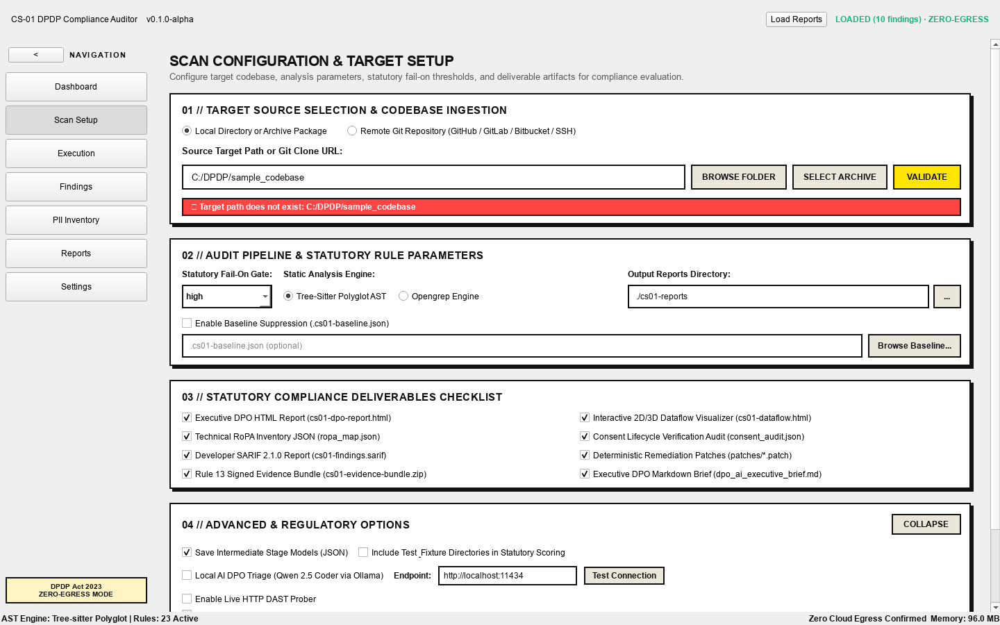
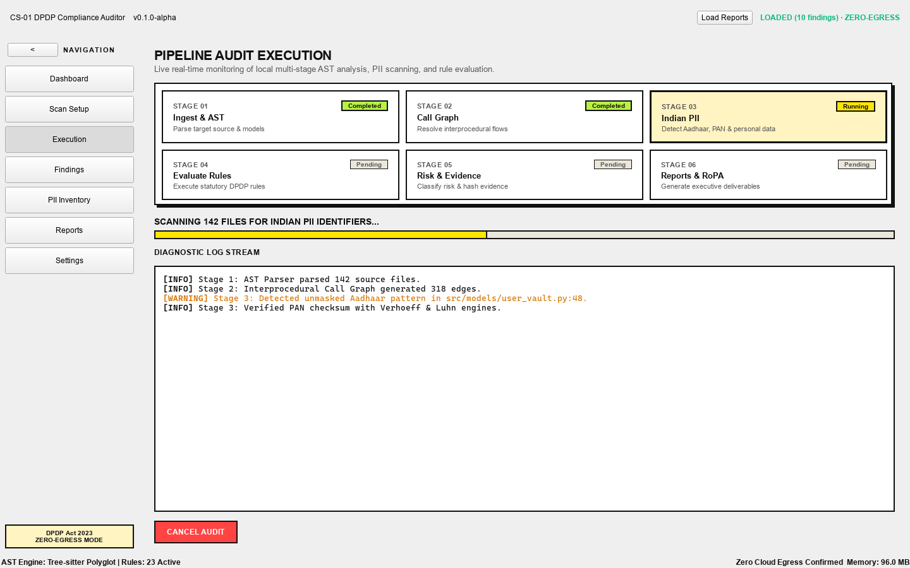
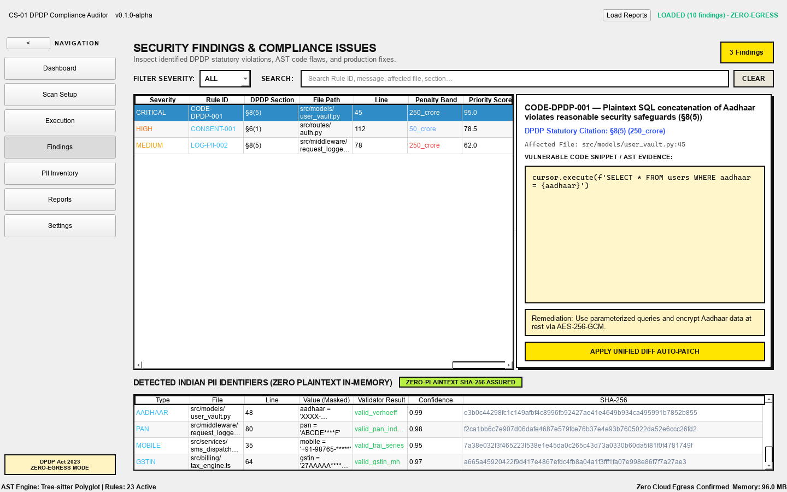
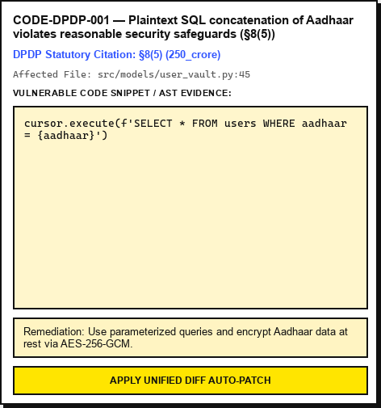
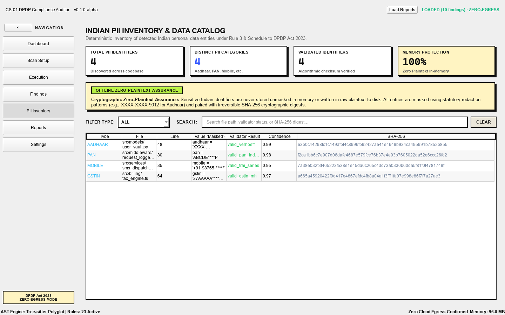
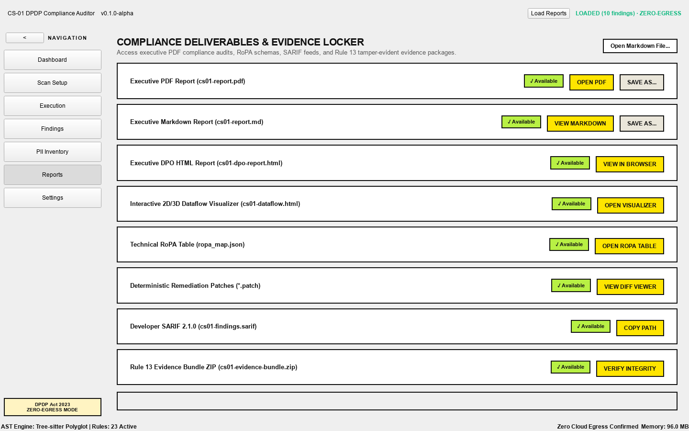
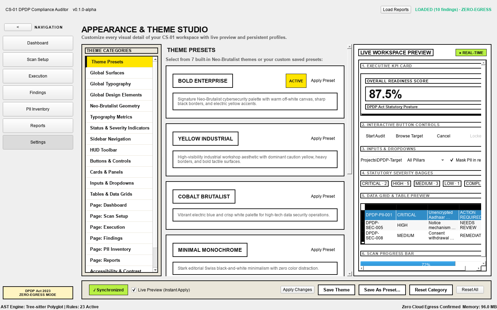
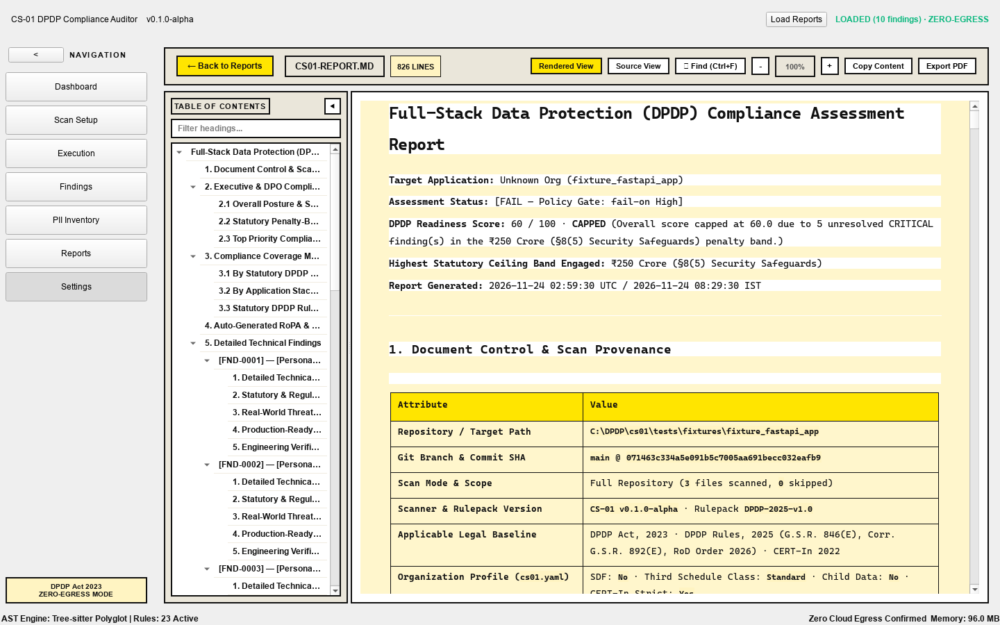

# CS-01 DPDP Compliance Auditor
*An intelligent desktop-based auditing tool for analysing software projects against India's Digital Personal Data Protection Act, 2023.*

[](LICENSE)
[](https://www.python.org/)
[](https://wiki.qt.io/Qt_for_Python)
[](file:///C:/DPDP/cs01/tests)
[](#privacy-and-zero-egress-guarantee)
[](file:///C:/DPDP/cs01/pyproject.toml)

---

<p align="center">
  
</p>

## Quick Navigation

- [Project Overview](#project-overview)
- [Application Screenshots Gallery](#application-screenshots-gallery)
  - [Executive Compliance Dashboard](#1-executive-compliance-dashboard)
  - [Scanning & Pipeline Execution](#2-scanning--pipeline-execution)
  - [Security Findings & Code Dossier](#3-security-findings--code-dossier)
  - [Indian PII Inventory](#4-indian-pii-inventory)
  - [Audit Report Management](#5-audit-report-management)
  - [Appearance & Theme Studio](#6-appearance--theme-studio)
  - [In-App Markdown Report Viewer](#7-in-app-markdown-report-viewer)
- [Key Capabilities & Features](#key-capabilities--features)
- [System Architecture](#system-architecture)
- [Technology Stack](#technology-stack)
- [Installation Guide](#installation-guide)
  - [Option A: Standalone Windows Binaries (Zero Python Setup)](#option-a-standalone-windows-binaries-zero-python-setup)
  - [Option B: Development Source Installation](#option-b-development-source-installation)
- [Desktop User Workflow](#desktop-user-workflow)
- [Audit Deliverables & Reports](#audit-deliverables--reports)
- [Privacy and Zero-Egress Guarantee](#privacy-and-zero-egress-guarantee)
- [Project Directory Structure](#project-directory-structure)
- [Testing and Verification](#testing-and-verification)
- [Limitations and Roadmap](#limitations-and-roadmap)
- [Contributing Guidelines](#contributing-guidelines)
- [License and Statutory Disclaimer](#license-and-statutory-disclaimer)

---

## Project Overview

### What is CS-01?
**CS-01 DPDP Compliance Auditor** is an enterprise-grade desktop static analysis and compliance auditing application specifically engineered to evaluate software codebases, database schemas, and cloud deployment manifests against India's **Digital Personal Data Protection Act, 2023 (DPDP Act)** and the **DPDP Rules, 2025** (G.S.R. 846(E), Corr. G.S.R. 892(E), and RoD Order 2026).

Modern privacy frameworks impose strict technical, architectural, and data governance obligations on organizations handling digital personal data ("Data Fiduciaries"). Non-compliance carries severe financial exposure under the statutory **Section 33 Schedule**:
- **Up to ₹250 Crore:** For failure to observe reasonable security safeguards to prevent personal data breaches under **Section 8(5)**.
- **Up to ₹200 Crore:** For failure to notify the Data Protection Board of India (DPBI) and affected Data Principals of a breach under **Section 8(6)**.
- **Up to ₹200 Crore:** For non-compliance with statutory safeguards regarding children's data and persons with disabilities under **Section 9**.
- **Up to ₹150 Crore:** For Significant Data Fiduciary (SDF) obligations under **Section 10**.
- **Up to ₹50 Crore:** For violation of notice, affirmative consent, and residual statutory duties under **Sections 5 & 6**.

### Primary Target Users
- **Data Protection Officers (DPOs) & Compliance Counsel:** Gain executive visibility into statutory exposure, readiness benchmarks, and pre-filled draft Records of Processing Activities (RoPA).
- **Security Architects & DevSecOps Teams:** Enforce DPDP compliance gates in local and CI/CD pipelines, prevent personal data leakage, and maintain cryptographic audit trails.
- **Software Engineering Teams:** Inspect intraprocedural AST walkthroughs, vulnerable code snippets, and apply instant, one-click unified diff auto-patches.

### Core Engineering Principles
1. **100% Offline / Zero Cloud Egress:** All AST parsers, regex scanners, mathematical checksum algorithms, and PDF/HTML report generators execute strictly on the local machine. Zero telemetry, zero external network calls, zero LLM cloud dependencies.
2. **Deterministic Mathematical Validation:** Replaces brittle regexes with formal algorithmic verifiers (Verhoeff $D_5$ group mathematics for Aadhaar, Luhn mod-36 for GSTIN, TRAI allocations for mobile).
3. **Bold Enterprise Neo-Brutalist UX:** A modern, distinctive interface designed for clarity and technical confidence—featuring thick black borders, hard offset shadows, high-contrast typography, and a dynamic theme engine.

---

## Application Screenshots Gallery

### 1. Executive Compliance Dashboard
The primary command center displays real-time compliance posture, statutory penalty exposure, dynamic readiness score capping, and status across all 8 DPDP pillars.

<p align="center">
  
</p>

*Key Highlights:*
- **DPDP Readiness Score Gauge:** 0–100 scale dynamically capped at 58.5–60.0 whenever unresolved Critical violations exist in the ₹250 Crore penalty band.
- **Section 33 Penalty Ceiling:** Automatically calculates the highest engaged statutory ceiling based on active violations.
- **8 Statutory Pillars:** Evaluates Notice & Consent, Security Safeguards, Breach Readiness, Storage Limitation, Children's Protection, SDF Duties, Principal Rights, and Cross-Border Transfers.

---

### 2. Scanning & Pipeline Execution
Configure scan parameters, fail-on severity gates, engine options, and watch the asynchronous 6-stage auditing pipeline run in real time.

| Scan Configuration | Pipeline Execution & Live HUD |
| :---: | :---: |
|  |  |
| *Select local repository, configure file exclusions, and set policy failure thresholds.* | *Live multi-stage progress meter, active stage HUD, and real-time streaming console logs.* |

---

### 3. Security Findings & Code Dossier
Review statutory violations, investigate AST taint paths, and apply verified remediation code patches.

| Comprehensive Findings Grid | Selected Finding Deep Dive & Auto-Patch |
| :---: | :---: |
|  |  |
| *Sortable findings table with severity badges, statutory citations, and penalty bands.* | *AST evidence, vulnerable code snippets, compliant remediation, and one-click auto-patch.* |

---

### 4. Indian PII Inventory
Deterministic discovery and verification of Indian personal identifiers across source files, logs, and database schemas with cryptographic zero-plaintext protection.

<p align="center">
  
</p>

*Key Highlights:*
- **Zero-Plaintext In-Memory Guarantee:** Discovered PII values are immediately masked using statutory redaction patterns (`XXXX-XXXX-9012`, `ABCDE****F`) and paired with irreversible SHA-256 digests.
- **Algorithmic Verification:** Displays exact mathematical validator results (`valid_verhoeff`, `valid_pan_individual`, `valid_trai_series`, `valid_gstin_mh`).

---

### 5. Audit Report Management
Access, preview, and export 15 audit deliverables with built-in cryptographic evidence bundle validation under Rule 13.

<p align="center">
  
</p>

*Key Highlights:*
- **One-Click Deliverable Actions:** Open Executive PDF, launch interactive HTML dashboards, explore draft RoPAs, or inspect SARIF 2.1.0 files.
- **Rule 13 Evidence Locker Verification:** Validates the cryptographic SHA-256 manifest and digital signatures of the audit evidence bundle directly inside the UI.

---

### 6. Appearance & Theme Studio
Complete visual control over the desktop interface with 7 built-in Neo-Brutalist presets, 16 token categories, and live workspace preview.

<p align="center">
  
</p>

*Key Highlights:*
- **Dynamic Live Application:** Customize surface backgrounds, borders, shadow offsets, and severity badges without restarting the application.
- **Built-in Presets:** *Bold Enterprise* (Default), *Yellow Industrial*, *Cobalt Brutalist*, *Minimal Monochrome*, *Dark High Contrast*, *Crimson Alert*, and *Emerald Privacy*.

---

### 7. In-App Markdown Report Viewer
A native, zero-external-app Markdown viewer embedded directly inside CS-01 for seamless navigation of formal compliance dossiers.

<p align="center">
  
</p>

*Key Highlights:*
- **Zero External Application Launches:** Read comprehensive reports without ever opening VS Code, Notepad, or an external browser.
- **Collapsible Hierarchical TOC:** Auto-generated from H1–H6 Markdown headers with instant anchor jumps and keyword filtering.
- **In-Document Search (Ctrl+F):** Real-time text search with match counters (`3 of 12 matches`), Next/Prev navigation, and case-sensitivity toggle.
- **Rendered / Source Toggle:** Switch smoothly between formatted Neo-Brutalist HTML layout and raw Markdown source with line number gutters.

---

## Key Capabilities & Features

### A. DPDP Statutory Compliance Auditing
- **8 Compliance Pillars:** Comprehensive evaluation across Notice & Consent (§5, §6), Security Safeguards (§8(5)), Personal Data Breach Readiness (§8(6)), Storage Limitation & Erasure (Rule 6), Children & PwD Protection (§9), Significant Data Fiduciary Obligations (§10, Rule 13), Principal Rights (§11–14), and Cross-Border Transfers (§16).
- **Statutory Capping Logic:** Reflects real-world regulatory risk by capping the overall readiness score at 58.5–60.0 whenever unresolved Critical violations exist in the ₹250 Crore penalty band.
- **Section 33 Schedule Penalty Estimation:** Automatically calculates maximum potential exposure based on the statutory schedule.

### B. Polyglot AST-Based Source Code Analysis
- **Polyglot Parsing via Tree-sitter:** Syntactic AST analysis across Python, JavaScript, TypeScript, Go, Java, and SQL without executing user code.
- **Database & Cloud Schema Auditing:** SQLGlot for PostgreSQL, MySQL, and SQLite DDLs; Prisma schema parsing; SQLAlchemy and Mongoose ORM models; python-hcl2 for Terraform cloud configurations; Dockerfile and Kubernetes manifest parsers.
- **Interprocedural Taint Tracking:** Traces data paths from untrusted sources and PII fields through intermediate application logic into egress sinks (loggers, public API calls, disk files).

### C. Pure-Math Indian PII Detection & Validation
- **Aadhaar:** Validates 12 digits using the **Verhoeff Dihedral $D_5$ group permutation algorithm** and verifies valid Institution Identifier Numbers (IIN).
- **Permanent Account Number (PAN):** Enforces 10-character structure `[A-Z]{3}[PCHFATBLJG][A-Z]\d{4}[A-Z]` verifying the 4th character against official entity types (Individual, Company, Firm, Trust, etc.).
- **GSTIN:** Validates 15 characters, ensuring valid Indian state codes, an embedded valid PAN, and a **Luhn mod-36 checksum**.
- **UPI Identifiers:** Validates handle structures against official NPCI PSP bank registries (`@okhdfcbank`, `@paytm`, `@ybl`, `@upi`, etc.).
- **Mobile Numbers:** Enforces Indian National Numbering Plan (NNP) allocations (E.164 +91 prefix, 10-digit series allocated to Indian telecom operators).
- **Other Supported Identifiers:** Driving Licences, ABHA Health IDs, Passports, Voter IDs (EPIC), IFSC Codes, and Payment Cards (Luhn mod-10).

### D. Automated Git Remediation Patches
- Automatically generates unified Git diff `.patch` files for detected code flaws.
- Includes pre-built sanitizers, parameterized SQL queries, AES-256-GCM encryption wrappers, and affirmative consent middleware templates.

---

## System Architecture

CS-01 executes a deterministic, 6-stage compliance auditing pipeline integrated directly with the PySide6 desktop GUI via asynchronous background worker threads:

```mermaid
flowchart TD
    subgraph Input ["Audit Targets"]
        T1["Local Source Directory"]
        T2["Git Repository URL"]
        T3["Zip / Tarball Archive"]
    end

    subgraph Pipeline ["CS-01 6-Stage Compliance Pipeline"]
        S1["Stage 1: Ingest & Classify<br/>• Safe Extraction (Zip-Slip protected)<br/>• Language & Framework Detection"]
        S2["Stage 2: Parse Polyglot ASTs & Schemas<br/>• Tree-sitter ASTs (Python, JS/TS, Go, Java)<br/>• SQLGlot Schemas & HCL2 Terraform"]
        S3["Stage 3: Detect Indian PII & Trace Flows<br/>• Verhoeff D₅, Luhn mod-36, TRAI Validators<br/>• Interprocedural Call Graph & Taint Tracing"]
        S4["Stage 4: Evaluate Statutory DPDP Rules<br/>• Pass A: Local File Checks (BOLA, DTOs)<br/>• Pass B: Whole-Repo Cross-File Posture<br/>• Cross-Layer Vulnerability Correlator"]
        S5["Stage 5: Score & Classify Risk<br/>• Finding Deduplication & Severity Scoring<br/>• Readiness Score (0-100) & Critical Capping<br/>• Baseline Suppression (Technical Debt)"]
        S6["Stage 6: Generate Deliverables<br/>• Executive A4 PDF Report (DirectWrite)<br/>• 2D/3D Data-Flow Cockpit (Three.js)<br/>• Markdown Report & SARIF 2.1.0<br/>• Rule 13 Cryptographic Evidence Locker"]
    end

    subgraph DesktopGUI ["PySide6 Neo-Brutalist Desktop GUI"]
        GUI_D["Executive Dashboard (KPIs, Pillars, Readiness)"]
        GUI_F["Security Findings & Code Dossier"]
        GUI_P["Indian PII Inventory (Zero-Plaintext)"]
        GUI_R["Audit Reports & Evidence Verification"]
        GUI_T["Appearance & Theme Studio (7 Presets)"]
        GUI_M["In-App Markdown Report Viewer"]
    end

    Input --> S1
    S1 --> S2
    S2 --> S3
    S3 --> S4
    S4 --> S5
    S5 --> S6
    S6 --> DesktopGUI
```



---

## Technology Stack

| Category | Technology | Purpose in CS-01 |
| :--- | :--- | :--- |
| **GUI Framework** | PySide6 (Qt 6.8+) | Neo-Brutalist desktop application, high-DPI scaling, QSS stylesheets, and native A4 PDF generation. |
| **Core Runtime** | Python 3.11+ | High-performance execution, strong type annotations, asynchronous subprocess workers. |
| **Data Models** | Pydantic v2 | Strict validation, serialization, and typing across all findings, graphs, and audit reports. |
| **AST Parsing** | Tree-Sitter & Language Pack | Fast polyglot syntactic parsing for Python, JavaScript, TypeScript, Go, and Java without code execution. |
| **Database Schemas** | SQLGlot | Multi-dialect parsing of SQL DDLs, Prisma schemas, SQLAlchemy models, and Mongoose definitions. |
| **Infrastructure** | python-hcl2, dockerfile-parse | Static parsing of Terraform `.tf` files, Dockerfiles, and Docker Compose configurations. |
| **Syntax Highlighting** | Pygments 2.19+ | Code highlighting in both the In-App Markdown Viewer and the Executive PDF Exporter. |
| **PDF Generation** | PySide6 `QPdfWriter` | Publication-grade A4 PDF generation with native DirectWrite font rasterization (zero cloud egress). |
| **Testing** | pytest, pytest-qt, pytest-cov | Comprehensive automated test suite with 225 unit and GUI tests. |
| **Packaging** | PyInstaller, Inno Setup 6 | Self-contained Windows dual-binary release (`cs01.exe` CLI + `cs01-gui.exe` GUI) and installer. |

---

## Installation Guide

### Option A: Standalone Windows Binaries (Zero Python Setup)
For non-developers, DPOs, or corporate workstations without Python installed:

1. Download or locate the compiled standalone distribution folder in `dist/CS-01/`.
2. Launch the desktop GUI by running:
   ```cmd
   dist\CS-01\cs01-gui.exe
   ```
   *(Or double-click `launch_gui.bat` in the repository root, which automatically resolves the compiled binary).*
3. For command-line execution or CI/CD pipelines, use the console executable:
   ```cmd
   dist\CS-01\cs01.exe scan "C:\path\to\your\project"
   ```

---

### Option B: Development Source Installation

#### 1. Prerequisites
- **Operating System:** Windows 10/11, Ubuntu 22.04+, or macOS 13+
- **Python:** Version 3.11 or newer
- **Git:** Available on system path

#### 2. Clone the Repository
```bash
git clone https://github.com/your-org/DPDP.git
cd DPDP
```

#### 3. Create and Activate Virtual Environment
- **Windows (PowerShell):**
  ```powershell
  python -m venv .venv
  .\.venv\Scripts\Activate.ps1
  ```
- **macOS / Linux (Bash/Zsh):**
  ```bash
  python3 -m venv .venv
  source .venv/bin/activate
  ```

#### 4. Install Dependencies
```bash
pip install --upgrade pip
pip install -e "./cs01[dev]"
```

#### 5. Launch the Desktop Application
```bash
# Launch via CLI command:
cs01 gui

# Or run the GUI module directly:
python -m cs01.gui
```

---

## Desktop User Workflow

```
1. LAUNCH APPLICATION ──► 2. SCAN SETUP ──► 3. PIPELINE AUDIT ──► 4. DASHBOARD REVIEW ──► 5. REMEDIATION ──► 6. EXPORT REPORTS
```

1. **Launch CS-01:** Start the application via `launch_gui.bat` or `python -m cs01.gui`.
2. **Configure Scan:** Navigate to **Scan Setup** in the sidebar. Select your target project folder or paste a Git repository URL. Choose your policy threshold (`fail-on: high`).
3. **Execute Audit:** Click **Start Audit Scan**. The execution view displays real-time progress across all 6 stages with streaming console logs.
4. **Review Dashboard:** Inspect your overall **DPDP Readiness Score**, check if statutory capping has been engaged, review Section 33 penalty ceilings, and inspect the 8 statutory pillars.
5. **Investigate Findings:** Jump to **Findings** to view discovered security flaws. Click any row to see AST evidence, statutory citations, and click **Apply Unified Diff Auto-Patch**.
6. **Inspect PII Catalog:** Open **PII Inventory** to review detected Aadhaar, PAN, GSTIN, or phone numbers with verified checksum status and zero plaintext in memory.
7. **Read & Export Reports:** Go to **Reports** to launch the **In-App Markdown Viewer** to read the full technical audit dossier, or click **Save As...** to export publication-grade A4 PDFs.

---

## Audit Deliverables & Reports

When an audit completes, CS-01 generates up to 15 structured artifacts in the output directory (`./cs01-reports/`):

| File Name | Deliverable Format | Description |
| :--- | :--- | :--- |
| `cs01-report.pdf` | Publication-Grade A4 PDF | Formal executive assessment with DPO summary, statutory tables, and before/after code diffs. |
| `cs01-report.md` | CommonMark / GFM | Complete technical audit report suitable for code reviews and internal wikis. |
| `cs01-dpo-report.html` | Interactive HTML | Executive compliance dashboard with pillar breakdowns and statutory matrices. |
| `cs01-dataflow.html` | Standalone HTML (1.3 MB) | Interactive 2D swimlane and 3D stacked-layer spatial visualization (Three.js/Cytoscape). |
| `cs01-findings.sarif` | OASIS SARIF 2.1.0 | Standard static analysis format compatible with GitHub Code Scanning, SonarQube, and VS Code. |
| `ropa_map.json` | JSON Schema | Automated draft Technical Record of Processing Activities under Section 8. |
| `consent_audit.json` | JSON Schema | Consent lifecycle audit covering collection notices, tracking, and withdrawal endpoints. |
| `cs01-compliance.json` | JSON Schema | Canonical machine-readable compliance register with full AST evidence pointers. |
| `gl-sast-report.json` | GitLab SAST JSON | Direct integration format for GitLab Security Dashboards. |
| `cs01-evidence-bundle.zip` | Rule 13 Cryptographic ZIP | Tamper-evident archive with SHA-256 manifests and signatures for statutory audit defense. |
| `remediation_patches/*.patch` | Unified Git Diffs | Auto-generated code patches implementing compliant remediation patterns. |

---

## Privacy and Zero-Egress Guarantee

Data privacy tools must not become vectors for data exposure. CS-01 enforces strict privacy protections by design:

1. **Zero Cloud Egress:** All scanning, parsing, rule evaluation, and report rendering run 100% locally on your hardware. No telemetry, analytics, or source code snippets are transmitted across the network.
2. **Zero-Plaintext In-Memory PII Handling:** Discovered personal data is never stored unmasked in memory or written in raw plaintext to disk. Real identifiers are masked using statutory formats (`XXXX-XXXX-9012` for Aadhaar, `ABCDE****F` for PAN) and paired with irreversible SHA-256 hashes.
3. **Zip-Slip Safe Ingestion:** Archive extraction logic prevents directory traversal vulnerabilities by strictly validating canonical paths prior to writing files.
4. **Local PDF Rendering:** PDF generation uses PySide6's internal paint engine with local DirectWrite font bindings—no external PDF printing binaries or third-party web services are invoked.

---

## Project Directory Structure

```
DPDP/
├── README.md                           # Main GitHub documentation (this file)
├── launch_gui.bat                      # Windows batch launcher (auto-detects standalone binary)
├── dist/                               # Standalone Windows packaging directory
│   ├── CS-01/
│   │   ├── cs01-gui.exe                # High-DPI Neo-Brutalist desktop application
│   │   └── cs01.exe                    # Fast headless CLI executable
│   └── CS-01-Setup.iss                 # Inno Setup 6 enterprise installer script
├── docs/                               # Project documentation & visual assets
│   ├── ARCHITECTURE.md                 # Deep-dive architectural specification
│   ├── USER_GUIDE.md                   # Comprehensive step-by-step user manual
│   ├── SECURITY.md                     # Security policy & zero-egress verification
│   └── screenshots/                    # Real application screenshots
│       ├── dashboard.png               # Executive KPI dashboard
│       ├── scan-setup.png              # Scan target & engine configuration
│       ├── execution.png               # Real-time pipeline execution & console HUD
│       ├── findings.png                # Security findings table & details
│       ├── finding-details.png         # Selected finding drawer with auto-patch
│       ├── pii-inventory.png           # Indian PII catalog with mathematical verification
│       ├── reports.png                 # Audit deliverables & Rule 13 evidence verification
│       ├── theme-studio.png            # Appearance & Theme Customization Studio
│       └── markdown-viewer.png         # In-App Markdown Report Viewer
├── cs01-reports/                       # Default output directory for generated deliverables
└── cs01/                               # Core Python package & application sources
    ├── pyproject.toml                  # Package dependencies and console script entrypoints
    ├── cs01/
    │   ├── cli/                        # Typer-based terminal interface commands
    │   ├── models/                     # Canonical Pydantic v2 schemas
    │   ├── pipeline/                   # The 6-Stage Statutory Auditing Pipeline
    │   │   ├── runner.py               # Main pipeline execution orchestrator
    │   │   ├── stage1_ingest/          # Target discovery, git cloning, and classification
    │   │   ├── stage2_parse/           # Tree-sitter polyglot AST, SQL, and IaC parsers
    │   │   ├── stage3_detect/          # Indian PII detection & mathematical checksums
    │   │   ├── stage4_evaluate/        # Pass A & Pass B statutory rule engines
    │   │   ├── stage5_classify/        # Risk priority scoring, capping, and deduplication
    │   │   └── stage6_report/          # PDF exporter, Markdown, SARIF, and evidence locker
    │   └── gui/                        # PySide6 Desktop GUI Application
    │       ├── app.py                  # High-DPI application bootstrap & font setup
    │       ├── main_window.py          # Shell window, HUD, navigation rail, and stack
    │       ├── theme.py                # Neo-Brutalist design tokens & color constants
    │       ├── qss_builder.py          # Dynamic Qt stylesheet compiler
    │       ├── theme_engine/           # Dynamic Theme Customization Studio engine
    │       ├── markdown_viewer/        # Dedicated in-app Markdown report viewer
    │       └── views/                  # Central functional application pages
    │           ├── dashboard_view.py   # Executive KPIs, readiness gauge, 8 pillars
    │           ├── scan_config_view.py # Target selection, exclusion, and engine options
    │           ├── scan_execution_view.py # Asynchronous progress meter & log console
    │           ├── results_view.py     # Findings table, code diffs, and auto-patches
    │           ├── pii_inventory_view.py # Indian PII data catalog
    │           ├── report_view.py      # Deliverables gallery & evidence verification
    │           └── settings_view.py    # Theme studio, presets, and color editors
    └── tests/                          # 225 Automated Unit & GUI Test Suites
        ├── gui/                        # PySide6 GUI test suite (114 tests)
        └── unit/                       # Pipeline, parsing, and validator tests (111 tests)
```

---

## Testing and Verification

CS-01 maintains an exhaustive automated test suite covering all pipeline stages, mathematical validators, and GUI components:

```bash
# Run the entire test suite (225 tests)
pytest cs01/tests -v

# Run PySide6 GUI desktop tests specifically (114 tests)
pytest cs01/tests/gui -v

# Run pipeline, AST parser, and PII validator unit tests (111 tests)
pytest cs01/tests/unit -v
```

### Verified Test Coverage Highlights
- **114 GUI Tests Passing:** Verifies application lifecycle, responsive resizing (1024×600 to 1920×1080), navigation rail switching, readiness gauge mathematics, dynamic capping threshold, theme token synchronization, and in-app Markdown search.
- **111 Unit & Pipeline Tests Passing:** Verifies Verhoeff $D_5$ Aadhaar vectors, Luhn mod-36 GSTIN checksums, TRAI mobile allocations, interprocedural taint flow tracing, SQL schema encryption checks, and Rule 13 tamper-evident ZIP verification.

---

## Limitations and Roadmap

### Current Limitations
- **Static Analysis Boundaries:** Dynamic runtime behavior, reflection-based route loading, or deeply nested runtime-injected dependencies may require explicit baseline or configuration guidance.
- **Compiled Binary Analysis:** CS-01 inspects source code, SQL DDLs, and cloud manifests; it does not decompile stripped C/C++ or machine binaries.
- **Live DAST Probing:** Live API probing (`--allow-live-probe`) is strictly opt-in and currently read-only.

### Development Roadmap
- [ ] **Automated Multi-Lingual Notice Verification:** Expanded static NLP checks verifying that privacy notices are provided in English and all 22 languages specified in the Eighth Schedule to the Constitution of India (§5(3)).
- [ ] **GitHub Action & GitLab CI Components:** Pre-built containerized actions for seamless continuous integration.
- [ ] **IDE Extensions:** Direct VS Code and JetBrains plugin integrations for real-time in-editor DPDP compliance highlighting.

---

## Contributing Guidelines

We welcome community contributions, bug reports, and additional statutory rule definitions!

1. **Fork the Repository:** Create your feature branch (`git checkout -b feature/new-rule`).
2. **Follow Invariants:**
   - **Zero Cloud Egress:** Analyzers and parsers must execute 100% locally.
   - **Declarative Rule Definitions:** Rule text, statutory citations, and penalty bands must live in declarative YAML definitions (`rules/pass_a/` or `rules/pass_b/`).
3. **Run Validation:**
   ```bash
   pytest cs01/tests -v
   ruff check cs01
   mypy cs01
   ```
4. **Submit a Pull Request:** Open a PR against `main` with a clear explanation of changes and test coverage.

---

## License and Statutory Disclaimer

### License
CS-01 DPDP Compliance Auditor is licensed under the **Apache License, Version 2.0**. See the [LICENSE](LICENSE) file for complete details.

### Statutory Legal Disclaimer
> [!IMPORTANT]
> **Technical Auditing Instrument — Not Formal Legal Advice:**
> CS-01 DPDP Compliance Auditor is a technical static analysis and engineering auditing tool designed to assist organizations in identifying potential compliance gaps against the Digital Personal Data Protection Act, 2023 and DPDP Rules, 2025. 
> 
> Statutory penalties cited in this tool and its generated deliverables represent the maximum statutory ceilings prescribed under the **Schedule to Section 33** of the DPDP Act, 2023. Actual penalties are discretionary and determined exclusively by the Data Protection Board of India (DPBI) based on the statutory factors set forth in Section 33(2). Use of this software or its generated reports does not guarantee regulatory compliance, provide formal legal immunity, or substitute for qualified legal counsel and accredited data protection audits.
