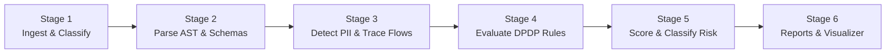

# CS-01: Full-Stack DPDP Compliance Auditor
*Automated Codebase, Database Schema, Cloud Infrastructure & Configuration Scanner for India's DPDP Act, 2023 & DPDP Rules, 2025*

[](LICENSE)
[](https://www.python.org/)
[]()
[]()
[]()

---

## 1. Project Overview

### What is CS-01?
**CS-01** is an open-core, local-first static compliance auditing instrument designed specifically to evaluate software systems against India's landmark **Digital Personal Data Protection Act, 2023 (DPDP Act)** and the **DPDP Rules, 2025** (G.S.R. 846(E), Corr. G.S.R. 892(E), and the RoD Order 2026).

Modern privacy regulations impose strict technical, architectural, and procedural obligations on companies handling personal data ("Data Fiduciaries"). Non-compliance can trigger statutory penalties of up to **₹250 Crore** for failing to implement reasonable security safeguards under Section 8(5), and up to **₹200 Crore** for failing to prevent personal data breaches or protect children's data under Sections 8(6) and 9.

### Purpose and Goals
1. **Bridge Law and Code:** Automatically translate high-level legal mandates (such as purpose limitation, consent withdrawal, storage limitation, and data minimization) into concrete, AST-level code, database schema, and cloud infrastructure checks.
2. **Zero Cloud Egress (100% Offline):** Guarantee that no source code, database credentials, or personal data ever leaves your local workstation or CI/CD environment.
3. **Full-Stack Auditing:** Evaluate all layers of an application simultaneously—from frontend forms and API routes to database schemas, container files, and cloud infrastructure configs.
4. **Interactive Data-Flow Visualization:** Automatically map and render personal data flows in both **2D architectural swimlanes** and **3D spatial stacked-layer models**, highlighting leaks, unconsented databases, and compliant controls.
5. **Audit-Ready Evidence & Remediation:** Generate tamper-evident cryptographic evidence packages (compliant with Rule 13), automated draft Records of Processing Activities (RoPA under Section 8), and git-applicable before/after code patches.

---

## 2. Installation Instructions

### Prerequisites
- **Operating System:** Windows, macOS, or Linux.
- **Python:** Python 3.11 or newer.
- **Git:** Installed and available on your system path.
- *(Optional)* **Ollama / Local LLM:** If you wish to use local offline AI triage (`qwen2.5-coder:3b`).

---

### Step-by-Step Setup Guide

#### Step 1: Clone the Repository
```bash
git clone https://github.com/your-org/DPDP.git
cd DPDP
```

#### Step 2: Create and Activate a Virtual Environment
It is strongly recommended to install CS-01 inside an isolated virtual environment:

- **Windows (PowerShell):**
  ```powershell
  python -m venv .venv
  .\.venv\Scripts\Activate.ps1
  ```
- **macOS / Linux (Bash/Zsh):**
  ```bash
  python3 -m venv .venv
  source .venv/bin/activate
  ```

#### Step 3: Install CS-01 in Editable Mode
Navigate into the `cs01` directory and install the package along with its developer dependencies:

```bash
cd cs01
pip install --upgrade pip
pip install -e ".[dev]"
```

#### Step 4: Verify the Installation
Verify that the `cs01` command-line interface is available:

```bash
cs01 --help
```

You should see the rich CLI banner and the list of available commands (`scan`, `audit`, `baseline`, `rules`, `verify-evidence`, `probe`).

#### Step 5: Run the Verification Test Suite
Ensure that all unit tests and accuracy benchmarks pass cleanly:

```bash
# Run all 102 unit tests
pytest tests -v

# Run the paired accuracy benchmark harness
python tests/accuracy_bench/evaluate.py
```

---

## 3. Technologies Used

CS-01 combines established parsing engines, deterministic mathematical validators, and client-side graph renderers into a unified, zero-egress auditor:

| Category | Technology / Library | Purpose in CS-01 |
|---|---|---|
| **Core Runtime** | Python 3.11+ | High-performance execution, strong typing, and asynchronous subprocess support. |
| **Data Validation** | Pydantic v2 | Strict validation, schemas, and serialization for findings, graphs, and reports. |
| **CLI & Terminal** | Typer & Click, Rich | Ergonomic command-line parsing, animated progress bars, status tables, and colored terminal logs. |
| **Source Code AST Parsing** | Tree-Sitter & Tree-Sitter Language Pack | Polyglot syntactic parsing for Python, JavaScript, TypeScript, JSX/TSX, Java, and Go without running user code. |
| **SQL & ORM Parsing** | SQLGlot | Multi-dialect parsing of SQL DDL files, SQLAlchemy models, Prisma schemas, and Mongoose definitions. |
| **Infrastructure Parsing** | python-hcl2, dockerfile-parse, ruamel.yaml | Parse Terraform `.tf` files, Dockerfiles, Docker Compose, and Kubernetes YAML manifests. |
| **Pattern Matching** | Python Regex & Opengrep Bridge | Fast lexical scanning and structural pattern correlation. |
| **Templating Engine** | Jinja2 & MarkupSafe | Render standalone offline HTML dashboards and Markdown compliance reports. |
| **2D Graph Visualization** | Cytoscape.js & Dagre *(Local Vendored)* | Interactive 2D architectural swimlane flow graph with path-isolation hovering. |
| **3D Spatial Visualization** | Three.js & OrbitControls *(Local Vendored)* | Interactive 3D stacked-layer spatial visualization with curved Bezier flow tubes and animated particles. |
| **Testing & Quality** | Pytest, Pytest-Cov | Unit testing, coverage analysis, and regression prevention across 102 tests. |

---

## 4. Code Structure

The repository is structured into clear, decoupled pipeline stages where each module operates strictly on typed Pydantic models:

```
DPDP/
├── README.md                           # Main project documentation (this file)
├── VULNERABILITY.md                    # Benchmark vulnerability catalog (MediVault reference)
├── cs01-reports/                       # Default output directory for generated reports
│   ├── cs01-report.md                  # Comprehensive Markdown audit report
│   ├── cs01-dpo-report.html            # Executive DPO HTML dashboard
│   ├── cs01-dataflow.html              # Standalone interactive 2D + 3D Data-Flow visualizer
│   ├── dataflow_graph.json             # Canonical machine-readable data-flow graph
│   ├── cs01-compliance.json            # Canonical compliance register
│   ├── cs01-findings.sarif             # SARIF 2.1.0 report for IDE & GitHub Code Scanning
│   ├── ropa_map.json                   # Draft Technical RoPA under Section 8
│   ├── consent_audit.json              # Consent lifecycle verification
│   └── cs01-evidence-bundle.zip        # Rule 13 tamper-evident signed evidence archive
└── cs01/                               # Main Python package
    ├── pyproject.toml                  # Package metadata, dependencies, and entrypoints
    ├── cs01/
    │   ├── cli/
    │   │   └── main.py                 # CLI entrypoint commands (scan, audit, baseline, etc.)
    │   ├── models/                     # Canonical Pydantic v2 data models
    │   │   ├── graph.py                # 2D/3D DataFlowGraph, GraphNode, GraphEdge schemas
    │   │   ├── raw_finding.py          # Raw statutory finding models before deduplication
    │   │   ├── scored_finding.py       # Scored findings, readiness score, and pillar models
    │   │   ├── repo_model.py           # AST summaries, SchemaRecords, and IacTrees
    │   │   └── flow_graph.py           # Sources, Sinks, Guards, and Taint Flow edges
    │   ├── pipeline/                   # The 6-Stage Compliance Auditing Pipeline
    │   │   ├── runner.py               # Orchestrator wiring all stages together
    │   │   ├── stage1_ingest/          # Ingestion, git cloning, zip unpacking, and file classification
    │   │   ├── stage2_parse/           # Polyglot AST, SQL schema, IaC, and .env parsers
    │   │   ├── stage3_detect/          # Indian PII detection, validators, and taint flow tracing
    │   │   │   └── validators/         # Pure-math validators (Verhoeff, Luhn, PAN, GSTIN, UPI)
    │   ├── stage4_evaluate/        # Statutory rule engines (Pass A local & Pass B cross-file)
    │   │   │   ├── pass_a_engine.py    # Local file checks (BOLA/IDOR, DTOs, static mounts, uploads)
    │   │   │   ├── pass_b_engine.py    # Whole-repo cross-file architectural checks
    │   │   │   └── correlator.py       # Cross-layer finding escalation (e.g. Upload + Public Mount)
    │   │   ├── stage5_classify/        # Deduplication, priority scoring, and readiness capping
    │   │   └── stage6_report/          # Multi-format report generators
    │   │       ├── graph_builder.py    # Target-agnostic 5-tier data-flow graph synthesizer
    │   │       ├── html_exporter.py    # Executive HTML DPO dashboard exporter
    │   │       ├── markdown_exporter.py# Formal Markdown assessment report generator
    │   │       ├── ropa_exporter.py    # Automated draft RoPA exporter
    │   │       ├── evidence_locker.py  # Rule 13 tamper-evident ZIP bundler
    │   │       └── visualizer/         # 2D/3D visualizer templates and vendored JS
    │   │           ├── template.py     # HTML/JS template for 2D Cytoscape + 3D Three.js
    │   │           └── vendor/         # Locally vendored JS (Cytoscape, Dagre, Three.js)
    │   ├── bonus/                      # Value-add compliance modules
    │   │   ├── consent_auditor/        # Verifies affirmative consent and withdrawal mechanisms
    │   │   ├── dast_prober/            # Opt-in read-only live API probe
    │   │   └── patch_generator/        # Deterministic git-applicable remediation patch creator
    │   └── utils/                      # In-memory PII redactor, git ingest, and zip-slip safety
    ├── rules/                          # Declarative YAML statutory rule definitions
    │   ├── pass_a/local_rules.yaml     # Per-file statutory rules (CODE, SQL, ENV, IAC)
    │   └── pass_b/cross_file_rules.yaml# Whole-repo architectural rules (ARCH)
    └── tests/                          # Automated test suites
        ├── test_graph_builder.py       # Multi-target generalization and hygiene tests
        ├── test_report_integrity.py    # Mathematical invariant and format tests
        └── accuracy_bench/             # 35 Paired positive/negative statutory fixtures
            └── evaluate.py             # Accuracy benchmark evaluator (precision, recall, F1)
```

---

## 5. Functionality Overview

### 1. The 6-Stage Compliance Auditing Pipeline
CS-01 executes an end-to-end, deterministic analysis pipeline:



1. **Stage 1 (Ingest & Classify):** Unpacks local directories, Git repositories, or archives (`.zip`, `.tar.gz`) safely in memory with Zip-Slip protection. Automatically detects project languages, frameworks, and stacks.
2. **Stage 2 (Parse):** Converts all application files into normalized, JSON-serializable records using Tree-Sitter for code ASTs, SQLGlot for database tables, and python-hcl2 for cloud configs.
3. **Stage 3 (Detect PII & Trace Flows):** Identifies personal data instances using deterministic pure-mathematical validators and constructs an interprocedural taint flow graph connecting sources, security guards, and egress sinks.
4. **Stage 4 (Evaluate DPDP Rules):** Evaluates statutory requirements across two complementary passes:
   - **Pass A (Local Engine):** Evaluates file-level AST structures (e.g. unauthenticated routes, missing IDOR checks, credential-leaking response DTOs, unvalidated uploads, unencrypted columns).
   - **Pass B (Cross-File Engine):** Audits the entire codebase for holistic compliance gaps (e.g. missing consent withdrawal routes under Section 6(4), lack of scheduled retention purge routines under Section 8(7), incomplete breach notification telemetry).
   - **Cross-Layer Correlator:** Compounds multi-layer vulnerabilities (for example, escalating an unvalidated upload from `HIGH` to `CRITICAL` if the upload directory is publicly exposed by a static framework mount).
5. **Stage 5 (Classify & Score Risk):** Deduplicates findings, computes prioritized risk scores, and calculates the overall **DPDP Readiness Score (0–100)** across 8 statutory pillars, automatically capping scores when acute critical risks are detected.
6. **Stage 6 (Generate Deliverables):** Produces formal audit reports, machine-readable registers, the draft RoPA, and the interactive 2D/3D visualization map.

---

### 2. Pure-Math Indian PII Validators
Generic regular expressions produce excessive false positives on random 10- or 12-digit numbers. CS-01 uses strict, official verification algorithms:
- **Aadhaar:** Validates 12 digits using the **Verhoeff Dihedral $D_5$ checksum algorithm** and verifies valid Institution Identifier Numbers (IIN).
- **Permanent Account Number (PAN):** Enforces `[A-Z]{3}[PCHFATBLJG][A-Z]\d{4}[A-Z]`, validating that the 4th character matches official entity types (Individual, Company, Firm, Trust, etc.).
- **GSTIN:** Validates 15 characters, ensuring valid Indian state codes, an embedded valid PAN, and a **Luhn mod-36 checksum**.
- **UPI Handles:** Verifies handles against the official NPCI PSP bank registry (`@okhdfcbank`, `@paytm`, `@ybl`, `@upi`, etc.).
- **Others:** Mobile numbers (TRRAI E.164 allocation), Passports, Voter IDs (EPIC), IFSC codes, and ABHA Health IDs.

---

### 3. Interactive 2D + 3D Personal Data-Flow & Leak Visualizer
CS-01 automatically synthesizes an architectural data-flow graph across 5 ordered tiers:
- **Tier 0: COLLECTION** — Frontend forms, client components, and public entrypoints.
- **Tier 1: API & AUTH LOGIC** — REST/GraphQL routes, controllers, middleware, and response DTOs.
- **Tier 2: STORAGE** — SQL tables, ORM models, and local disk upload directories.
- **Tier 3: CLOUD INFRASTRUCTURE** — Terraform, Kubernetes, and Docker DB services *(omitted honestly if the repository lacks IaC)*.
- **Tier 4: EGRESS SINKS** — Application loggers, public static file mounts, third-party APIs, and Shadow AI.

#### Two Synchronized Views:
- **2D Architectural Swimlane View:** Built on Cytoscape.js and Dagre. Renders clean, left-to-right architectural columns with hover path isolation to trace a complete data leak vector from source to sink.
- **3D Spatial Stacked-Layer View:** Built on Three.js and OrbitControls. Active tiers are rendered as stacked horizontal glass planes with curved Bezier tubes and **animated glowing particle streams** (fast crimson particles on PII leaks, pulsing amber particles on unconsented storage).
- **Click-to-Inspect Drawer:** Clicking any node or edge in 2D or 3D opens a detailed side panel displaying detected PII tags, control checklists, exact file:line references, and statutory DPDP citations.

---

### 4. Automated Compliance Artifacts
- **Executive DPO HTML Dashboard (`cs01-dpo-report.html`):** Modern dark-themed dashboard presenting readiness scores, penalty ceiling matrices, and remediation roadmaps.
- **Standalone 2D/3D Cockpit (`cs01-dataflow.html`):** 100% self-contained offline visualization that can be opened directly in any browser with zero network requests.
- **Automated RoPA Draft (`ropa_map.json`):** A pre-filled technical Record of Processing Activities ready for legal review under Section 8.
- **Tamper-Evident Evidence Bundle (`cs01-evidence-bundle.zip`):** Rule 13-compliant ZIP archive containing all scan artifacts along with a SHA-256 manifest and digital signatures.
- **Automated Fix Patches (`remediation_patches/`):** Unified Git `.patch` files providing deterministic before/after code fixes.

---

## 6. User Guide

### 1. Basic Audit Commands

#### Audit a Local Folder
Scan any local codebase and write reports to `./cs01-reports`:
```bash
cs01 scan /path/to/your/project
```

#### Audit a Software Archive
Scan a `.zip` or `.tar.gz` package without manually extracting it:
```bash
cs01 scan /path/to/application.zip
```

#### Audit a Remote Git Repository
Directly audit a remote repository:
```bash
cs01 scan https://github.com/org/repo.git --git-ref main
```

---

### 2. Common CLI Options

| Flag | Description | Default |
|---|---|---|
| `--output-dir <path>` | Directory where all audit reports and deliverables are saved. | `./cs01-reports` |
| `--fail-on <level>` | Exit with code `1` (Policy Fail) if findings meet or exceed severity (`critical`, `high`, `medium`, `never`). | `high` |
| `--format <types>` | Deliverable formats to generate (`all`, `html`, `sarif`, `json`, `markdown`). | `all` |
| `--baseline <file>` | Path to `.cs01-baseline.json` to suppress existing debt and only alert on new regressions. | None |
| `--allow-live-probe` | Opt-in to execute read-only live API probing against declared endpoints. | `False` |
| `--ai-triage` | Enable local offline LLM triage using Ollama. | `False` |

---

### 3. Managing Technical Debt in CI/CD (Baselining)

When introducing CS-01 into an existing codebase with legacy debt, you can establish a baseline so that the scanner only flags **new violations** introduced in pull requests:

```bash
# 1. Generate the initial baseline file
cs01 baseline create /path/to/project --output .cs01-baseline.json

# 2. In CI/CD pipelines, run scans against the baseline
cs01 scan /path/to/project --baseline .cs01-baseline.json --fail-on high
```

---

### 4. Understanding Your Readiness Score

The **DPDP Readiness Score (0–100)** represents your application's posture across the 8 statutory pillars:
1. **Notice & Consent** (Sections 5 & 6)
2. **Reasonable Security Safeguards** (Section 8(5))
3. **Personal Data Breach Readiness** (Section 8(6))
4. **Storage Limitation & Erasure** (Section 8(7))
5. **Children's & PwD Protection** (Section 9)
6. **Significant Data Fiduciary Obligations** (Section 10)
7. **Data Principal Rights** (Sections 11–14)
8. **Cross-Border Transfers & CERT-In Overlap** (Section 16 & IT Act §70B)

> [!WARNING]
> **Readiness Score Capping:** If an application contains open `CRITICAL` findings in high-penalty bands (such as hardcoded credentials or unmasked PII flows), CS-01 automatically caps the readiness score at **42–49 / 100**, reflecting acute legal exposure regardless of performance in other pillars.

---

## 7. Contribution Guidelines

We welcome community contributions, additional DPDP rule definitions, and framework parsers!

### How to Contribute
1. **Fork the Repository:** Create your own feature branch (`git checkout -b feature/new-dpdp-rule`).
2. **Follow Architectural Invariants:**
   - **Zero Cloud Egress:** All parsers and analyzers must execute 100% locally.
   - **Law-Agnostic Analyzers:** Analyzers must emit purely technical `RawFinding` objects. Statutory text, penalties, and citations must live exclusively in `rules/pass_a/local_rules.yaml` or `rules/pass_b/cross_file_rules.yaml`.
   - **Zero Overfitting:** Never hardcode application-specific variable names or file paths in analyzers. Use generalizable AST patterns.
3. **Add Paired Accuracy Benchmarks:**
   - Every new rule must include paired **True Positive (TP)** and **True Negative (TN)** fixtures in `tests/accuracy_bench/fixtures/`.
   - Ensure the accuracy benchmark maintains **100% precision and recall**:
     ```bash
     python tests/accuracy_bench/evaluate.py
     ```
4. **Run Unit Tests & Linters:**
   ```bash
   pytest tests -v
   ruff check .
   mypy cs01
   ```
5. **Submit a Pull Request:** Open a PR against `main` with a clear description of the new rule or bug fix.

---

## 8. License Information

CS-01 is licensed under the **Apache License, Version 2.0**.

```
Copyright 2026 CS-01 Contributors

Licensed under the Apache License, Version 2.0 (the "License");
you may not use this file except in compliance with the License.
You may obtain a copy of the License at

    http://www.apache.org/licenses/LICENSE-2.0

Unless required by applicable law or agreed to in writing, software
distributed under the License is distributed on an "AS IS" BASIS,
WITHOUT WARRANTIES OR CONDITIONS OF ANY KIND, either express or implied.
See the License for the specific language governing permissions and
limitations under the License.
```

---

### Statutory Notice & Disclaimer
*CS-01 is a technical compliance auditing and static analysis tool. Penalties under India's Digital Personal Data Protection Act, 2023 represent statutory maximum ceilings prescribed in the Schedule to the Act. Actual penalties are discretionary and determined by the Data Protection Board of India (DPBI) based on factors listed under Section 33(2). This software and its generated reports do not constitute formal legal advice.*
