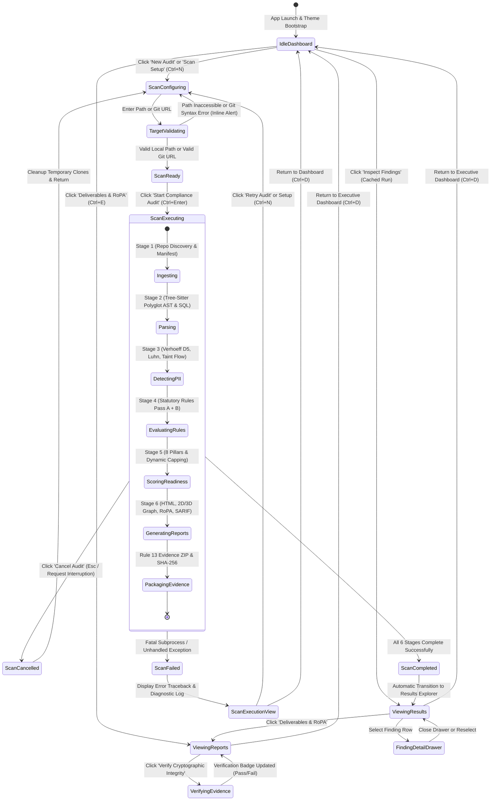

# CS-01 DPDP Compliance Desktop Application — Design and Development Plan

**Document Version:** 1.0.0-PROD  
**Target Platform:** PySide6 (Qt for Python 6.12+) on Python 3.11  
**Regulatory Standards:** India Digital Personal Data Protection (DPDP) Act 2023, DPDP Rules 2025, CERT-In Cyber Security Directions 2022  
**Core Package Target:** `cs01.gui` under `C:\DPDP\cs01\cs01\gui\`  
**Document Author:** CS-01 Architecture & Implementation Team  
**Status:** Approved for Implementation (Milestone 1 Deliverable)

---

## Executive Overview

The **CS-01 Desktop Application** provides a sovereign, offline-first, zero-cloud-egress graphical interface for India's Digital Personal Data Protection (DPDP) Act 2023 compliance auditing engine. Designed specifically for Data Protection Officers (DPOs), legal compliance auditors, and DevSecOps engineering leads, CS-01 transforms complex polyglot AST static analysis, SQL schema classification, infrastructure-as-code validation, and Indian PII detection into an actionable executive cockpit.

This document establishes the exhaustive architectural blueprint, visual design specifications, component models, asynchronous threading contracts, accessibility standards, and onboarding mechanisms required for production implementation.

---

## Section 1: Detailed Screen Wireframes & UI Component Architecture

The desktop application operates on a responsive desktop layout optimized for display resolutions ranging from **1280x720** (minimum supported) to **1920x1080** (full desktop standard) and **2560x1440/4K** (high-DPI workstation). The user interface is structured around four primary operational screens managed via a `QStackedWidget` controlled by a persistent, collapsible navigation sidebar.

---

### 1.1 Screen 1: Executive Audit Dashboard (`DashboardView`)

The Dashboard View delivers an immediate, high-level posture assessment of the audited codebase. It visualizes the overall DPDP readiness score (0–100), statutory penalty exposure under Section 33, compliance breakdown across the 8 statutory pillars, and high-priority active violations.

```
+==========================================================================================================================================================+
| [🛡️ CS-01] CS-01 DPDP Compliance Auditor v0.1.0-alpha    [● OFFLINE ZERO-EGRESS] [Target: https://github.com/Harsh3338M/HealthCare.git] [⚡ AST Active] [?] [_][□][X]|
+==========================================================================================================================================================+
| NAV RAIL   | AUDIT EXECUTIVE DASHBOARD                                                                            [ 🔄 Run New Audit ] [ 📥 Export Report ▾ ] |
| (64/220px) | Scan ID: 8540caef · Engine: Tree-sitter AST · Target Files: 84 · Scan Timestamp: 2026-11-23 11:48:32 UTC · Evaluation Mode: Strict (Fail-On: HIGH) |
|            +---------------------------------------------------------------------------------------------------------------------------------------------+
| [📊 Dash ]*| ⚠️  STATUTORY ALERT: MAXIMUM CEILING ₹250 CRORE ENGAGED · SECTION 8(5) REASONABLE SECURITY SAFEGUARDS BREACH RISK                           |
|            | Discretionary statutory maximum ceiling under DPDP Act 2023 Schedule. Actual penalties determined by DPBI inquiry under Section 33(2).     |
| [⚙️  Scan ] |+--------------------------------+--------------------------------+--------------------------------+-----------------------------------------+
|            || DPDP READINESS SCORE           || STATUTORY MAXIMUM CEILING     || CRITICAL VIOLATIONS           || HIGH SEVERITY FINDINGS                 |
| [📋 Find ] ||                                ||                                ||                                ||                                         |
|            ||          .------------.        ||          ₹250 CRORE           ||               39               ||                   07                    |
| [📦 RoPA ] ||         /   ______     \       ||                                ||                                ||                                         |
|            ||        |   /      \     |      || Section 8(5) Security Breach   || Immediate Remediation Required || 30-Day Mandatory Rectification        |
| [📖 Docs ] ||        |  |  41.9  |    |      || Failure to implement technical || Statutory High-Penalty Band   || Data Principal Rights & Notice         |
|            ||        |   \______/     |      || safeguards for personal data.  || Capping score to max 60.0.    || Potential audit disclosure risk.       |
|            ||         \              /       ||                                ||                                ||                                         |
|            ||          '------------'        || [ Discretionary DPBI Ceiling ] || [ View 39 Critical Findings ] || [ View 07 High Findings ]              |
|            || [!] SCORE DYNAMICALLY CAPPED   ||                                ||                                ||                                         |
|            ||     AT 41.9/100 (HIGH PENALTY) ||                                ||                                ||                                         |
|            |+--------------------------------+--------------------------------+--------------------------------+-----------------------------------------+
|            | COMPLIANCE BY STATUTORY PILLAR (DPDP ACT 2023 & DPDP RULES 2025 MANDATES)                                                                   |
|            |+-------------------------------+-------------------------------+-------------------------------+-----------------------------------------+
|            || 1. Notice & Consent (§5, §6)  || 2. Security Safeguards (§8.5)|| 3. Breach Readiness (§8.6)   || 4. Retention & Erasure (Rule 8)         |
|            || [ 0.0% ] [                    ]|| [ 0.0% ] [                    ]|| [ 0.0% ] [                    ]|| [ 40.0% ] [========                  ]  |
|            || Status: NON-COMPLIANT (0/3)   || Status: NON-COMPLIANT (0/8)   || Status: NON-COMPLIANT (0/1)   || Status: AT RISK (2/5)                  |
|            |+-------------------------------+-------------------------------+-------------------------------+-----------------------------------------+
|            || 5. Children Protection (§9)   || 6. SDF Governance (§10)      || 7. Principal Rights (Rule 14) || 8. Cross-Border & CERT-In (Rule 15)    |
|            || [ 60.0% ] [============       ]|| [ 100.0% ] [===================]|| [ 75.0% ] [===============   ]|| [ 100.0% ] [===================]       |
|            || Status: ATTENTION (0/1)       || Status: COMPLIANT (1/1)       || Status: SATISFACTORY (1/2)    || Status: COMPLIANT (2/2)                |
|            |+-------------------------------+-------------------------------+-------------------------------+-----------------------------------------+
|            | ACTIVE CRITICAL & HIGH FINDINGS PREVIEW                                                                           [ 🔍 View All 46 Findings ]|
|            |+--------+---------------+----------+-----------------------------------+-----------------------------------------+--------------------------+
|            || SEV    | RULE ID       | SECTION  | LOCATION                          | DETECTED VIOLATION & IMPACT             | ACTION                   |
|            |+--------+---------------+----------+-----------------------------------+-----------------------------------------+--------------------------+
|            || [CRIT] | CODE-DPDP-001 | §8(5)    | backend/app/main.py:54            | Personal data logged into console sink  | [ Inspect Finding ➔ ]    |
|            || [CRIT] | SQL-DPDP-001  | §8(5)    | backend/app/models.py:13 (User)   | Unencrypted database column: 'aadhaar'  | [ Inspect Finding ➔ ]    |
|            || [CRIT] | IAC-DPDP-001  | §8(5)    | infra/terraform/rds.tf:22         | RDS storage_encrypted flag is 'false'   | [ Inspect Finding ➔ ]    |
|            || [HIGH] | ARCH-DPDP-001 | §6(4)    | backend/app/routes/ (Missing)     | Missing affirmative consent withdrawal  | [ Inspect Finding ➔ ]    |
|            || [HIGH] | ARCH-DPDP-002 | §8(7)    | backend/app/tasks/ (Missing)      | Missing automated retention purge job   | [ Inspect Finding ➔ ]    |
|            |+--------+---------------+----------+-----------------------------------+-----------------------------------------+--------------------------+
+------------+---------------------------------------------------------------------------------------------------------------------------------------------+
| STATUS BAR | Engine: Tree-sitter Polyglot | Dialects: SQLGlot Multi | Local LLM: Offline | Memory: 142.4 MB | Egress: 0 B (Air-Gapped) | Status: READY   |
+==========================================================================================================================================================+
```

#### Detailed Layout & Dimension Specifications (`DashboardView`)
- **Overall Container:** Minimum size `1280 x 720` px; target resolution `1920 x 1080` px.
- **Header HUD (Top):** Height `56px`, full width. Background `#0F172A`. Contains title label (`16pt Bold`), zero-egress pill badge, active scan target path label, engine mode indicator, and window control buttons.
- **Statutory Alert Banner:** Height `48px`, margins `8px 16px 8px 16px`. Crimson background `#EF4444` with `0.15` opacity, solid `1px` border `#EF4444`. Prominently renders Section 8(5) ceiling notification with statutory disclaimer.
- **Top Metric Card Row:** Height `220px`, 4-column horizontal layout with `12px` inter-card spacing:
  - *Card 1 (Readiness Gauge):* Width `25%`. Hosts `ReadinessGaugeWidget` (diameter `160px`). Draws a radial score arc with color interpolation (Crimson `<60`, Gold `60-79`, Emerald `>=80`). Displays dynamically capped indicator badge (`#EF4444`).
  - *Card 2 (Penalty Ceiling):* Width `25%`. Displays statutory maximum amount in `20pt Bold` font (`#F8FAFC`), statutory citation (`#94A3B8`), and disclaimer link.
  - *Card 3 (Critical Findings):* Width `25%`. Large numerical count (`24pt Bold` `#EF4444`), description text, and direct navigation push button.
  - *Card 4 (High Findings):* Width `25%`. Large numerical count (`24pt Bold` `#F97316`), description text, and direct navigation push button.
- **Pillar Scorecard Grid:** 2 rows of 4 cards, total height `180px`. Each card (`PillarCardWidget`) has height `82px`, title with statutory citation, score percentage label, custom progress bar (`8px` track, rounded corners), and pass/fail rule count.
- **Recent Findings Table:** Expands to fill remaining vertical height (min `180px`). Uses `QTableView` with custom alternating row colors and interactive action push buttons.

---

### 1.2 Screen 2: Scan Configuration / Input View (`ScanConfigView`)

The Scan Configuration View enables operators to configure and validate scan targets. It supports local codebase directories, software archives (`.zip`, `.tar.gz`) with Zip-Slip path traversal protection, and remote Git repository URLs with branch/ref parsing.

```
+==========================================================================================================================================================+
| [🛡️ CS-01] CS-01 DPDP Compliance Auditor v0.1.0-alpha    [● OFFLINE ZERO-EGRESS] [Target: Configuration Setup]                  [⚡ AST Active] [?] [_][□][X]|
+==========================================================================================================================================================+
| NAV RAIL   | SCAN CONFIGURATION & TARGET SETUP                                                                                                           |
| (64/220px) | Configure target codebase, analysis parameters, statutory fail-on thresholds, and deliverable artifacts for compliance evaluation.         |
|            +---------------------------------------------------------------------------------------------------------------------------------------------+
| [📊 Dash ] | TARGET SOURCE SELECTION                                                                                                                     |
|            | [●] Local Directory or Archive Package                     [ ] Remote Git Repository (GitHub / GitLab / Bitbucket / SSH)                     |
| [⚙️  Scan ]*+---------------------------------------------------------------------------------------------------------------------------------------------+
|            | LOCAL REPOSITORY / ARCHIVE INGESTION                                                                                                        |
| [📋 Find ] | Source Target Path:                                                                                                                         |
|            | +-----------------------------------------------------------------------------------------------+ +-------------------+ +-------------------+ |
| [📦 RoPA ] | | C:\DPDP\quickrupee-backend                                                                    | | 📁 Browse Folder | | 🗜️  Select Archive| |
|            | +-----------------------------------------------------------------------------------------------+ +-------------------+ +-------------------+ |
| [📖 Docs ] | [✓] VALID LOCAL TARGET: 54 code files, 8 SQL schemas, 2 IaC trees detected. Zip-Slip guard active. Total size: 14.8 MB. (Read-Only Access)     |
|            +---------------------------------------------------------------------------------------------------------------------------------------------+
|            | REMOTE GIT REPOSITORY CONFIGURATION (OPTIONAL TAB / ACCORDION)                                                                              |
|            | Git Clone URL:                                                                                                                              |
|            | +-----------------------------------------------------------------------------------------------------------------------------------------+ |
|            | | https://github.com/organization/quickrupee-microservices.git                                                                            | |
|            | +-----------------------------------------------------------------------------------------------------------------------------------------+ |
|            | Git Branch / Ref:                       Clone Depth:                       Access Token (Optional for Private Repos):                           |
|            | +-------------------------------------+ +--------------------------------+ +------------------------------------------------------------------+ |
|            | | main                                | | [ 1 ] (Shallow Clone)        | | •••••••••••••••••••••••••••••••••••••••••••••••••••••••••••••• | |
|            | +-------------------------------------+ +--------------------------------+ +------------------------------------------------------------------+ |
|            +---------------------------------------------------------------------------------------------------------------------------------------------+
|            | AUDIT PIPELINE & RULE CONFIGURATION                                                                                                         |
|            | Statutory Fail-On Gate Threshold:        Static Analysis Engine:               Output Reports Directory:                                    |
|            | +--------------------------------------+ +----------------------------------+ +----------------------------------------------------+ +-----+ |
|            | | HIGH (Default - Recommended)       ▾ | | Tree-Sitter Polyglot AST (Def) ▾ | | C:\DPDP\cs01-reports                               | |... | |
|            | +--------------------------------------+ +----------------------------------+ +----------------------------------------------------+ +-----+ |
|            |                                                                                                                                             |
|            | CI/CD Baseline Regression Suppression:                                                                                                      |
|            | [ ] Enable Baseline Suppression (.cs01-baseline.json)   File: [ C:\DPDP\.cs01-baseline.json                          ] [ Browse Baseline... ]   |
|            +---------------------------------------------------------------------------------------------------------------------------------------------+
|            | COMPLIANCE DELIVERABLES CHECKLIST                                                                                                           |
|            | [☑] Executive DPO HTML Report (cs01-dpo-report.html)        [☑] Interactive 2D/3D Dataflow Visualizer (cs01-dataflow.html)                     |
|            | [☑] Technical RoPA Inventory JSON (ropa_map.json)           [☑] Consent Lifecycle Verification Audit (consent_audit.json)                       |
|            | [☑] Developer SARIF 2.1.0 Report (cs01-findings.sarif)      [☑] Deterministic Remediation Patches (patches/*.patch)                             |
|            | [☑] Rule 13 Signed Evidence Bundle (cs01-evidence-bundle.zip with SHA-256 manifest and sidecars)                                            |
|            +---------------------------------------------------------------------------------------------------------------------------------------------+
|            | ADVANCED & REGULATORY OPTIONS                                                                                                               |
|            | [☑] Save Intermediate Stage Models (JSON)                  [ ] Include Test & Fixture Directories in Statutory Scoring                      |
|            | [ ] Local AI DPO Triage (Qwen 2.5 Coder via Ollama)         Endpoint: [ http://localhost:11434                    ] [ 🔌 Test Connection ]    |
|            | [ ] DAST Safeguard Live HTTP Prober [!] (Requires explicit written authorization; probes TLS 1.3, HSTS, and live privacy notices)           |
|            +---------------------------------------------------------------------------------------------------------------------------------------------+
|            |                                                                        [ 🔄 Reset Defaults ]      [ 🚀 START COMPLIANCE AUDIT (Ctrl+Enter) ]|
+------------+---------------------------------------------------------------------------------------------------------------------------------------------+
| STATUS BAR | Ready to initiate audit. Valid target specified. Offline engine active.                                                   | Status: STANDBY |
+==========================================================================================================================================================+
```

#### Detailed Layout & Dimension Specifications (`ScanConfigView`)
- **Target Selection Header:** Radio button group (`QRadioButton`) styled as a segmented toggle bar. Height `36px`. Switches between Local and Remote input modes.
- **Local Input Group:** Height `90px`. Input field (`QLineEdit`) with height `36px`, rounded corners (`4px`), border `#334155`. Accompanied by "Browse Folder" and "Select Archive" buttons (`QPushButton`) with height `36px`, width `140px`.
  - *Validation Badge:* Dynamic label below input. Evaluates `Path.exists()`, directory traversal risks, and archive headers. Shows green checkmark `#10B981` or red alert `#EF4444`.
- **Remote Git Input Group:** Height `140px`. Clone URL field with regex format validator (`is_git_url()`). Secondary row houses Branch input (`QLineEdit`), Clone Depth (`QSpinBox`, range `1-50`, default `1`), and Private Token field (`echoMode = QLineEdit.Password`).
- **Pipeline Parameters Section:** 3-column layout:
  - *Fail-On Gate:* `QComboBox` offering options: `CRITICAL`, `HIGH` (default), `MEDIUM`, `NEVER`.
  - *SAST Engine:* `QComboBox` offering: `Tree-Sitter Polyglot AST` (default), `Opengrep SAST`, `All Engines`.
  - *Output Directory:* `QLineEdit` with folder browse action, defaulted to `./cs01-reports`.
- **Deliverables Checklist:** `QGridLayout` displaying 7 checkboxes (`QCheckBox`) styled with custom indicator boxes (`16x16px`) and text labels.
- **Action Footer:** Height `52px`. Right-aligned action buttons: "Reset Defaults" (`#334155` background) and "START COMPLIANCE AUDIT" primary CTA button (`#2563EB` royal blue, height `40px`, width `260px`, `11pt Bold` text).

---

### 1.3 Screen 3: Scanning Results & Live Execution View (`ResultsView` / `ScanExecutionView`)

This screen serves a dual purpose: during scan execution, it visualizes the 6-stage pipeline progress and streams real-time logs; once complete, it transitions into an interactive findings browser and Indian PII catalog with finding detail inspection.

```
+==========================================================================================================================================================+
| [🛡️ CS-01] CS-01 DPDP Compliance Auditor v0.1.0-alpha    [● OFFLINE ZERO-EGRESS] [Target: quickrupee-backend]                   [⚡ AST Active] [?] [_][□][X]|
+==========================================================================================================================================================+
| NAV RAIL   | LIVE AUDIT EXECUTION & FINDINGS EXPLORER                                                                                                    |
| (64/220px) | Target: C:\DPDP\quickrupee-backend · Scan ID: d9a41b2c · Engine: Tree-sitter · Status: Completed in 3.42s · 46 Total Findings Detected    |
|            +---------------------------------------------------------------------------------------------------------------------------------------------+
| [📊 Dash ] | 6-STAGE COMPLIANCE PIPELINE EXECUTION STEPPER                                                                                               |
|            | [✓ 1. Ingest (0.4s)] ➔ [✓ 2. Parse (0.8s)] ➔ [✓ 3. Detect PII (0.6s)] ➔ [✓ 4. Evaluate (0.7s)] ➔ [✓ 5. Classify (0.3s)] ➔ [✓ 6. Report (0.5s)]   |
| [⚙️  Scan ] | Progress: [==============================================================================================================] 100% (6/6 Complete)|
|            +---------------------------------------------------------------------------------------------------------------------------------------------+
| [📋 Find ]*| VIEW MODE:  [ (●) Interactive Findings Explorer (46) ]   [ ( ) Indian PII Catalog (12 Hits) ]   [ ( ) Live Execution Console Log ]            |
|            +---------------------------------------------------------------------------------------------------------------------------------------------+
| [📦 RoPA ] | FILTER AND SEARCH FINDINGS:                                                                                                                 |
|            | Search: [ 🔍 Filter by file, rule, variable name, or snippet...                     ]   Pillar: [ All 8 Pillars                  ▾ ]        |
| [📖 Docs ] | Severity: [☑] Critical (39)   [☑] High (07)   [ ] Medium (00)   [ ] Low (00)                 Category: [ All Categories (AST/SQL/IaC)  ▾ ]        |
|            +---------------------------------------------------------------------------------------------------------------------------------------------+
|            | FINDINGS TABLE (SPLITTER CONTAINER - 60% WIDTH)                  || FINDING DETAIL INSPECTOR (SPLITTER CONTAINER - 40% WIDTH)               |
|            |+--------+---------------+----------+----------------------------+|| Selected: CODE-DPDP-001 · Severity: CRITICAL                            |
|            || SEV    | RULE ID       | SECTION  | FILE & LOCATION            ||| Statutory Penalty Ceiling: ₹250 Crore (§8(5))                            |
|            |+--------+---------------+----------+----------------------------+|| Description: Personal data flows directly into an unmasked logger sink.  |
|            || [CRIT] | CODE-DPDP-001 | §8(5)    | backend/app/main.py:54     ||| Statutory Mandate: DPDP Act 2023 §8(5), Rule 6(1)(a) Security Safeguards |
|            || [CRIT] | SQL-DPDP-001  | §8(5)    | backend/app/models.py:13   ||| Remediation: Wrap personal data with mask_pii() before passing to sinks. |
|            || [CRIT] | IAC-DPDP-001  | §8(5)    | infra/rds.tf:22            ||+------------------------------------------------------------------------+|
|            || [CRIT] | CODE-DPDP-001 | §8(5)    | backend/app/auth.py:88     ||| CODE SNIPPET (backend/app/main.py:54):                                 ||
|            || [HIGH] | ARCH-DPDP-001 | §6(4)    | backend/app/routes/ (Miss) |||   52: def process_kyc_submission(request):                              ||
|            || [HIGH] | ARCH-DPDP-002 | §8(7)    | backend/app/tasks/ (Miss)  |||   53:     aadhaar_num = request.json.get("aadhaar")                     ||
|            || [HIGH] | CODE-DPDP-003 | §8(5)    | backend/tests/mock.py:42   ||| > 54:     _logger.info("KYC payload: %s", request.data) # [VIOLATION]   ||
|            || [HIGH] | ARCH-DPDP-005 | §8(6)    | Whole Repository (Miss)    |||   55:     return verify_aadhaar(aadhaar_num)                            ||
|            || [CRIT] | SQL-DPDP-001  | §8(5)    | backend/app/models.py:47   ||+------------------------------------------------------------------------+|
|            || [CRIT] | IAC-DPDP-004  | §8(5)    | infra/s3.tf:12             ||| AST TAINT-FLOW TRACE:                                                  ||
|            || [CRIT] | CODE-DPDP-001 | §8(5)    | backend/app/payments.py:31 ||| [Source: HTTP Request Body] ➔ [Symbol: request.data]                  ||
|            || [CRIT] | SQL-DPDP-001  | §8(5)    | backend/app/models.py:92   ||| ➔ [Sink: _logger.info (Unsanitized)]                                    ||
|            || [HIGH] | CODE-DPDP-002 | §5       | backend/app/forms.py:19    ||+------------------------------------------------------------------------+|
|            |+--------+---------------+----------+----------------------------+|| [ 💻 Open in IDE ]  [ 📝 View Diff Patch ]  [ 🚫 Suppress in Baseline ]  |
|            +------------------------------------------------------------------++-------------------------------------------------------------------------+
|            | INDIAN PII CATALOG (ACTIVE WHEN TAB 2 SELECTED)                                                                                             |
|            | Identifier Type | File Path & Line            | File Role  | Conf | Strictly Masked Value (In-Memory)  | SHA-256 Hash Digest (Truncated)    |
|            | Aadhaar Number  | backend/tests/fixtures.py:12| TEST       | 1.00 | XXXX-XXXX-9012 [👁️ Show]           | e3b0c44298fc1c149afbf4c8996fb92427 |
|            | PAN Card        | backend/app/models.py:14    | PRODUCTION | 1.00 | ABCDE****F     [👁️ Show]           | 8540caef9371a5c68912ef029104b90123 |
|            | GSTIN Number    | backend/app/billing.py:82   | PRODUCTION | 0.95 | 27XXXXX1234X1Z5[👁️ Show]           | a4b1c2d3e4f5a6b7c8d9e0f1a2b3c4d5e6 |
+------------+---------------------------------------------------------------------------------------------------------------------------------------------+
| STATUS BAR | 46 findings loaded | 12 Indian PII hits cataloged | Capped Score: 41.9/100 | Log buffer: 148 lines | Execution: SUCCESS  | Status: READY     |
+==========================================================================================================================================================+
```

#### Detailed Layout & Dimension Specifications (`ResultsView`)
- **6-Stage Visual Stepper:** Height `44px`. Displays 6 distinct stage badges in horizontal alignment:
  - Stages: `1. Ingest`, `2. Parse`, `3. Detect PII`, `4. Evaluate`, `5. Classify`, `6. Report`.
  - State rendering: Finished stages show green checkmark `#10B981`; currently active stage pulses with blue border `#38BDF8`; queued stages show muted slate `#64748B`.
- **Progress Bar (`QProgressBar`):** Height `10px`, background `#1E293B`, fill `#2563EB`, text hidden.
- **View Mode Switcher:** Tab bar (`QTabBar`) switching between:
  1. *Interactive Findings Explorer* (default)
  2. *Indian PII Catalog*
  3. *Live Execution Console Log*
- **Main Content Splitter (`QSplitter`):** Horizontal orientation:
  - *Left Pane (Findings Table, 60% width):* Search bar (`QLineEdit`, height `32px`), Severity filter chips (`QPushButton` or `QCheckBox`), and `QTableView` with columns: Severity, Rule ID, Section, File Path, Line, Actions.
  - *Right Pane (Finding Detail Drawer, 40% width):* Height fills container. Hosts `FindingDetailDrawer`. Contains Rule Title (`12pt Bold`), Penalty Ceiling Tag (`#EF4444`), plain-language description, scrollable code snippet area (`QPlainTextEdit` with monospace font, dark background `#070A10`, syntax highlighting, and violation marker `>`), taint flow trail, and action buttons.
- **Indian PII Catalog View:** Alternate view in main stack. Table displaying detected Indian identifiers with in-memory masking (`XXXX-XXXX-9012`, `ABCDE****F`), file role tags (PRODUCTION, TEST, FIXTURE), confidence score, and `PiiMaskedLabel` widgets featuring eye toggle buttons.

---

### 1.4 Screen 4: Report Generation & Deliverables View (`ReportGenerationView`)

The Report Generation & Deliverables View serves as the compliance regulatory clearinghouse. It organizes all generated statutory deliverables into an interactive 8-card grid, provides instant embedded preview and browser launching, and features a one-click Rule 13 cryptographic integrity verification engine.

```
+==========================================================================================================================================================+
| [🛡️ CS-01] CS-01 DPDP Compliance Auditor v0.1.0-alpha    [● OFFLINE ZERO-EGRESS] [Target: quickrupee-backend]                   [⚡ AST Active] [?] [_][□][X]|
+==========================================================================================================================================================+
| NAV RAIL   | COMPLIANCE DELIVERABLES & REGULATORY ARTIFACTS                                                                                              |
| (64/220px) | Reports generated in: C:\DPDP\cs01-reports · Ready for DPO review, legal filing, Board inspection, and developer remediation.              |
|            +---------------------------------------------------------------------------------------------------------------------------------------------+
| [📊 Dash ] | [🛡️ RULE 13 CRYPTOGRAPHIC INTEGRITY STATUS: ALL 11 DELIVERABLE FILES VERIFIED · SHA-256 MANIFEST MATCHES · ZERO TAMPERING DETECTED ]      |
|            +---------------------------------------------------------------------------------------------------------------------------------------------+
| [⚙️  Scan ] | DELIVERABLE ARTIFACTS MATRIX                                                                                                                |
|            |+-------------------------------------------------------------++-------------------------------------------------------------+ |
| [📋 Find ] || 📑 EXECUTIVE DPO COMPLIANCE DASHBOARD                       || 🌐 2D + 3D INTERACTIVE DATA-FLOW & LEAK VISUALIZER           | |
|            || File: cs01-dpo-report.html (71.6 KB)                        || File: cs01-dataflow.html (1.41 MB)                          | |
| [📦 RoPA ]*|| Complete statutory compliance report for Board & DPO review. || Interactive Cytoscape.js 2D swimlanes & Three.js 3D spatial  | |
|            || Pillar progress, Section 33 penalty ceilings, priority list.|| stacked-layer flow tubes with leak particle animations.     | |
| [📖 Docs ] || [ 🌐 Launch in Browser ]  [ 👁️ View Embedded WebEngine ]    || [ 🚀 Launch 2D/3D Cockpit ]  [ 📁 Reveal in File Explorer ] ||
|            |+-------------------------------------------------------------++-------------------------------------------------------------+ |
|            |+-------------------------------------------------------------++-------------------------------------------------------------+ |
|            || 📋 TECHNICAL RoPA DRAFT (SECTION 8 INVENTORY)               || ⚖️  CONSENT LIFECYCLE VERIFICATION AUDIT                     | |
|            || File: ropa_map.json (22.7 KB)                               || File: consent_audit.json (1.01 KB)                         | |
|            || Automated Record of Processing Activities mapping PII types || Verifies affirmative notice, consent purpose limitation,    | |
|            || to storage tables, processing purposes, and legal basis.    || and withdrawal routes required by DPDP Rules 2025 Rule 3 & 4| |
|            || [ 📊 Open RoPA Table Viewer ]  [ 💾 Export as CSV ]         || [ 🔍 View Consent Audit ]  [ 📋 Copy Statutory Summary ]     | |
|            |+-------------------------------------------------------------++-------------------------------------------------------------+ |
|            |+-------------------------------------------------------------++-------------------------------------------------------------+ |
|            || 💻 DEVELOPER SARIF 2.1.0 REPORT                             || 📦 RULE 13 TAMPER-EVIDENT EVIDENCE BUNDLE                  | |
|            || File: cs01-findings.sarif (123.6 KB)                        || File: cs01-evidence-bundle.zip (426.6 KB)                  | |
|            || GitHub Code Scanning & GitLab SAST compatible SARIF 2.1.0   || Cryptographically signed ZIP archive containing all models, | |
|            || export with precise line locations and rule documentation.  || reports, and SHA-256 sidecars for SDF regulatory filing.   | |
|            || [ 📋 Copy Path for CI/CD ]  [ 🔍 Inspect SARIF JSON ]       || [ 🔒 VERIFY CRYPTOGRAPHIC INTEGRITY ]  [ 💾 Export Bundle ] ||
|            |+-------------------------------------------------------------++-------------------------------------------------------------+ |
|            |+-------------------------------------------------------------++-------------------------------------------------------------+ |
|            || 🔧 DETERMINISTIC CODE REMEDIATION PATCHES                   || 📝 EXECUTIVE DPO MARKDOWN BRIEF                             | |
|            || Directory: patches/ (1 unified git patch generated)         || File: dpo_ai_executive_brief.md (9.2 KB)                   | |
|            || Production-ready unified diff patches resolving violations  || Synthesized executive compliance brief summarizing statutory| |
|            || (e.g. Terraform storage encryption, log retention).         || exposure, liability ceilings, and recommended action plans. | |
|            || [ 📝 View Unified Diff Viewer ]  [ 🚀 Apply Patch ]         || [ 👁️ Preview Markdown ]  [ 🖨️ Export Printable PDF ]        | |
|            |+-------------------------------------------------------------++-------------------------------------------------------------+ |
|            +---------------------------------------------------------------------------------------------------------------------------------------------+
|            | BATCH REGULATORY ACTIONS:                                                                                                                   |
|            | [ 🔒 Package All into Evidence ZIP ]   [ 📁 Open Output Directory in Explorer ]   [ 🏷️ Generate New CI/CD Baseline (.cs01-baseline.json) ]  |
+------------+---------------------------------------------------------------------------------------------------------------------------------------------+
| STATUS BAR | All 8 regulatory deliverables generated successfully | Evidence bundle verified: VALID | Rule 13 compliant       | Status: DELIVERABLES READY |
+==========================================================================================================================================================+
```

#### Detailed Layout & Dimension Specifications (`ReportGenerationView`)
- **Integrity Status Banner:** Height `42px`. Background `#10B981` (0.15 opacity), border `#10B981`. Displays cryptographic verification summary with lock icon.
- **Deliverables Matrix:** 2-column, 4-row grid layout with `14px` horizontal and vertical spacing. Each deliverable card (`QFrame`) has:
  - Height `150px`.
  - Background `#1E293B`, subtle border `#334155`, rounded corners `6px`.
  - Card Header: Deliverable icon, title (`11pt Bold`), file name and size in code font (`9.5pt` `#94A3B8`).
  - Card Description: 2-line summary in secondary font (`10pt Regular` `#94A3B8`).
  - Action Button Row: Dual buttons with height `30px`, styled with subtle hover effects.
- **Modal Dialog Launchers:**
  - *RoPA Table Viewer:* Launches `RopaTableDialog(QDialog)` modal (`1000 x 600` px) presenting `ropa_map.json` in a filterable table with columns: Data Category, PII Type, Source Location, DB Table/Column, Storage Encryption, Legal Basis, and Retention Period.
  - *Diff Patch Viewer:* Launches `DiffViewerDialog(QDialog)` modal (`900 x 600` px) with split/unified view of `.patch` files using green `#10B981` for additions and red `#EF4444` for deletions.
  - *Embedded DPO Report:* Launches `QDialog` hosting `QWebEngineView` rendering `cs01-dpo-report.html` offline.
- **Batch Actions Bar:** Bottom layout with three high-priority workflow buttons: "Package All into Evidence ZIP", "Reveal in Explorer", and "Generate New Baseline".

---

## Section 2: Complete Design Specifications

The visual identity of CS-01 intentionally rejects generic, "AI-generated" neon gradients, purple sci-fi themes, and low-contrast palettes. It is built around an authoritative **Dark Corporate Governance** design system tailored for legal-technical audits, risk consulting, and board-level reporting.

---

### 2.1 Corporate Governance Design Philosophy
- **Authoritative & Serious:** Grounded in deep midnight slate, cold steel borders, and high-contrast typography. Conveys the regulatory gravity of India's statutory privacy mandates.
- **Zero-Egress Brand Promise:** Constant visual cues (HUD lock icon, status bar indicator) assuring auditors that zero code, PII, or metadata ever leaves the local machine.
- **Statutory Severity Alignment:** Direct visual mapping between DPDP Act Section 33 statutory penalty bands and UI severity colors.
- **Pixel-Crisp Density:** High information density suitable for enterprise software engineering and legal compliance auditing.

---

### 2.2 Color Palette & Semantic Design Tokens

Every color in CS-01 is defined as a semantic token in `cs01.gui.theme`. The palette satisfies WCAG AAA contrast requirements against primary surface backgrounds.

| Token Name | Hex Code | RGB Value | RGBA Value | WCAG Contrast (vs Base) | Semantic Role / Governance Application |
|---|---|---|---|---|---|
| `--color-bg-base` | `#090D16` | `rgb(9, 13, 22)` | `rgba(9, 13, 22, 1.0)` | — (Base) | Deepest background well, application window root |
| `--color-bg-surface` | `#0F172A` | `rgb(15, 23, 42)` | `rgba(15, 23, 42, 1.0)` | 1.15:1 | Navigation sidebar, top header HUD, card containers |
| `--color-bg-card` | `#1E293B` | `rgb(30, 41, 59)` | `rgba(30, 41, 59, 1.0)` | 1.45:1 | Deliverable cards, metric tiles, table headers |
| `--color-bg-input` | `#070A10` | `rgb(7, 10, 16)` | `rgba(7, 10, 16, 1.0)` | 1.05:1 | Text fields, combo boxes, code snippet wells |
| `--color-border-subtle` | `#334155` | `rgb(51, 65, 85)` | `rgba(51, 65, 85, 1.0)` | 2.10:1 | Standard card borders, table grid lines, dividers |
| `--color-border-strong` | `#475569` | `rgb(71, 85, 105)` | `rgba(71, 85, 105, 1.0)` | 3.20:1 | Focused inputs, active tabs, panel splitters |
| `--color-text-primary` | `#F8FAFC` | `rgb(248, 250, 252)`| `rgba(248, 250, 252, 1.0)`| 18.57:1 (AAA) | Primary labels, screen titles, readiness score display |
| `--color-text-secondary`| `#94A3B8` | `rgb(148, 163, 184)`| `rgba(148, 163, 184, 1.0)`| 7.58:1 (AAA vs Base) / 6.96:1 (AA vs Surface) | Metric subtitles, secondary descriptions, metadata |
| `--color-text-muted` | `#64748B` | `rgb(100, 116, 139)`| `rgba(100, 116, 139, 1.0)`| 4.08:1 (WCAG AA Inactive/Disabled, Exempt under WCAG 1.4.3) | Disabled labels, placeholder text, queued stages |
| `--color-accent-blue` | `#38BDF8` | `rgb(56, 189, 248)` | `rgba(56, 189, 248, 1.0)` | 9.07:1 (AAA) | Active nav item, brand shield, focus ring indicator |
| `--color-accent-royal` | `#2563EB` | `rgb(37, 99, 235)` | `rgba(37, 99, 235, 1.0)` | 3.76:1 (vs Base) / 4.94:1 (#F8FAFC text on button, WCAG AA) | Primary CTA buttons ("Start Compliance Audit") |
| `--color-accent-navy` | `#1D4ED8` | `rgb(29, 78, 216)` | `rgba(29, 78, 216, 1.0)` | 4.2:1 | Hover state for primary buttons |
| `--color-risk-critical` | `#EF4444` | `rgb(239, 68, 68)` | `rgba(239, 68, 68, 1.0)` | 5.8:1 (AA) | Band 1 (₹250 Cr), CRITICAL findings, score capping |
| `--color-risk-critical-bg`| `#EF4444`| `rgb(239, 68, 68)` | `rgba(239, 68, 68, 0.15)` | — | Background tint for critical severity badges |
| `--color-risk-high` | `#F97316` | `rgb(249, 115, 22)` | `rgba(249, 115, 22, 1.0)` | 6.5:1 (AA) | Bands 2 & 3 (₹200 Cr), HIGH findings, urgent audit risk |
| `--color-risk-high-bg` | `#F97316` | `rgb(249, 115, 22)` | `rgba(249, 115, 22, 0.15)` | — | Background tint for high severity badges |
| `--color-risk-medium` | `#EAB308` | `rgb(234, 179, 8)` | `rgba(234, 179, 8, 1.0)` | 9.1:1 (AAA) | Band 4 (₹150 Cr), MEDIUM findings, warning progress |
| `--color-risk-medium-bg`| `#EAB308` | `rgb(234, 179, 8)` | `rgba(234, 179, 8, 0.15)` | — | Background tint for medium severity badges |
| `--color-risk-low` | `#3B82F6` | `rgb(59, 130, 246)` | `rgba(59, 130, 246, 1.0)` | 5.4:1 (AA) | Band 5 (₹50 Cr), LOW / procedural findings |
| `--color-risk-low-bg` | `#3B82F6` | `rgb(59, 130, 246)` | `rgba(59, 130, 246, 0.15)` | — | Background tint for low severity badges |
| `--color-status-success`| `#10B981` | `rgb(16, 185, 129)`| `rgba(16, 185, 129, 1.0)`| 7.2:1 (AAA) | Compliant score (>=80), verified evidence bundle |
| `--color-status-success-bg`| `#10B981`| `rgb(16, 185, 129)`| `rgba(16, 185, 129, 0.15)`| — | Background tint for verified evidence banner |

---

### 2.3 Typography Hierarchy Table

Typography balances high legibility across executive dashboards with precise monospaced formatting for source code snippets, line numbers, and SHA-256 digests.

- **Primary Typeface (UI & Headings):** `Segoe UI Variable Text`, `Segoe UI`, `Inter`, `-apple-system`, `sans-serif`.
- **Monospace Typeface (Code & Hashes):** `Cascadia Code`, `Consolas`, `JetBrains Mono`, `monospace`.

| Style Level | Primary Font Family | Size (pt / px) | Weight (Name & Int) | Line Height | Letter Spacing | Semantic Usage |
|---|---|---|---|---|---|---|
| **Display 1** | Primary UI Sans | `24pt / 32px` | Bold (`700`) | `1.20` | `-0.02em` | Readiness Score Radial Gauge center number (`41.9`) |
| **Display 2** | Primary UI Sans | `20pt / 26px` | Bold (`700`) | `1.25` | `-0.01em` | Maximum Statutory Penalty Ceiling amount (`₹250 CRORE`) |
| **Heading 1** | Primary UI Sans | `16pt / 21px` | Bold (`700`) | `1.30` | `-0.01em` | Primary View Titles ("Audit Dashboard", "Scan Configuration") |
| **Heading 2** | Primary UI Sans | `13pt / 17px` | SemiBold (`600`) | `1.40` | `0.00em` | Section Headers ("Compliance by Statutory Pillar", "Deliverables Matrix") |
| **Heading 3** | Primary UI Sans | `11pt / 15px` | SemiBold (`600`) | `1.40` | `0.00em` | Deliverable card titles, metric tile headers, modal dialog titles |
| **Body Primary** | Primary UI Sans | `10pt / 13px` | Regular (`400`) | `1.50` | `0.00em` | Explanatory descriptions, form field labels, finding descriptions |
| **Body Bold** | Primary UI Sans | `10pt / 13px` | SemiBold (`600`) | `1.50` | `0.00em` | Table column headers, emphasis text, active navigation labels |
| **Caption / Badge**| Primary UI Sans | `8.5pt / 11px` | SemiBold (`600`) | `1.20` | `+0.02em` | Severity tags (`CRITICAL`), penalty badges, stage stepper labels |
| **Code Display** | Monospace Code | `9.5pt / 13px` | Regular (`400`) | `1.45` | `0.00em` | File paths, line numbers, code snippets, diffs, SHA-256 hashes |
| **Code Bold** | Monospace Code | `9.5pt / 13px` | Bold (`700`) | `1.45` | `0.00em` | Highlighted AST violation tokens within snippet viewer |

---

### 2.4 Iconography Standard

All visual symbols in CS-01 adhere to a strict **1.5px stroke geometry** vector standard. Icons are rendered via embedded SVGs or custom `QPainter` paths to ensure crisp rendering at any Windows DPI scaling level (100%, 125%, 150%, 200%).

| Icon Identifier | Category | Visual Geometry / Glyph | Semantic Meaning & Context | Qt/SVG Implementation |
|---|---|---|---|---|
| `shield-trust` | Brand & Status | Shield outline with inner checkmark | Offline zero-egress guarantee; verified compliance posture | SVG `<path>` stroke `#38BDF8` |
| `shield-alert` | Brand & Status | Shield outline with centered exclamation mark | Active statutory capping; high-risk violations detected | SVG `<path>` stroke `#EF4444` |
| `lock-verified`| Evidence | Padlock shackle closed with keyhole dot | Rule 13 tamper-evident evidence bundle verified | SVG `<path>` stroke `#10B981` |
| `nav-dashboard`| Navigation | Circular speedometer gauge with needle | Switch to Executive Dashboard View (`Ctrl+D`) | SVG `<path>` stroke `#94A3B8` |
| `nav-scan` | Navigation | Folder icon superimposed with search crosshair | Switch to Scan Configuration View (`Ctrl+N`) | SVG `<path>` stroke `#94A3B8` |
| `nav-results` | Navigation | Hierarchical table list with checkmarks | Switch to Results Explorer & Live Stream View | SVG `<path>` stroke `#94A3B8` |
| `nav-reports` | Navigation | Document sheet with seal / ribbon | Switch to Deliverables & RoPA Center (`Ctrl+E`) | SVG `<path>` stroke `#94A3B8` |
| `nav-rules` | Navigation | Open statutory law book with scales | Switch to Rules & Statutory Mandates Reference | SVG `<path>` stroke `#94A3B8` |
| `sev-critical` | Severity | Octagonal alert stop-sign with exclamation point | CRITICAL finding (Penalty Band 1: ₹250 Cr) | Vector glyph in `#EF4444` |
| `sev-high` | Severity | Warning triangle with exclamation mark | HIGH finding (Penalty Bands 2 & 3: ₹200 Cr) | Vector glyph in `#F97316` |
| `sev-medium` | Severity | Circle enclosing lowercase letter 'i' | MEDIUM finding (Penalty Band 4: ₹150 Cr) | Vector glyph in `#EAB308` |
| `sev-low` | Severity | Pennant flag pointing right | LOW / Informational finding (Band 5: ₹50 Cr) | Vector glyph in `#3B82F6` |
| `action-play` | Control | Rightward-pointing equilateral triangle | Trigger "Start Compliance Audit" (`Ctrl+Enter`) | SVG filled `#F8FAFC` |
| `action-stop` | Control | Solid square | Cooperative abort / cancel running audit (`Esc`) | SVG filled `#EF4444` |
| `eye-masked` | Privacy Control| Eye outline with diagonal slash bar | PII masking active; click to momentarily reveal | SVG `<path>` stroke `#94A3B8` |
| `eye-revealed`| Privacy Control| Open eye outline with central pupil dot | PII currently revealed; release to re-mask | SVG `<path>` stroke `#38BDF8` |
| `ext-launch` | Integration | Square box with arrow exiting top-right corner | Launch report in system default web browser | SVG `<path>` stroke `#94A3B8` |
| `diff-patch` | Remediation | Dual horizontal arrows (source to target) | Open unified diff patch remediation dialog | SVG `<path>` stroke `#10B981` |

---

## Section 3: User Flow Diagrams & State Transitions

The application operates as a deterministic finite-state machine (FSM). User navigation, asynchronous pipeline execution, cancellation signals, and error handling strictly follow defined transitions.

---

### 3.1 End-to-End Mermaid State Transition Diagram



---

### 3.2 Application State Table

| State Name | Allowed User Actions | Active UI Views & Components | Navigation Sidebar State | Background Worker Thread Status |
|---|---|---|---|---|
| `STATE_IDLE_DASHBOARD` | Start new scan, inspect cached findings, launch HTML reports, open RoPA viewer, export PDF | `DashboardView` visible; Metric tiles, Gauge, and Pillar scorecard populated | Fully unlocked and interactive | Inactive / Terminated |
| `STATE_SCAN_CONFIGURING`| Edit source paths, browse directory, select archive, enter Git URL, toggle engines, select deliverables | `ScanConfigView` visible; Target input fields active, live validation running | Fully unlocked and interactive | Inactive |
| `STATE_TARGET_VALIDATING`| Type text, paste clipboard | Validation logic running on keystroke debounce (300ms) | Fully unlocked | Inactive |
| `STATE_SCAN_EXECUTING` | Cancel scan (`Esc`), toggle log auto-scroll, copy streaming log lines | `ScanExecutionView` visible; 6-stage stepper animating, progress bar active, cancel button enabled | Locked / Disabled (prevents view switching during audit) | `AuditPipelineWorker(QThread)` running Stages 1 through 6 |
| `STATE_SCAN_CANCELLED` | Return to scan configuration, view partial execution logs | `ScanExecutionView` displays cancellation banner; "Return to Setup" button active | Unlocked | Cooperative cleanup terminating, temp files unlinked |
| `STATE_SCAN_FAILED` | Inspect error traceback, copy logs, report issue, retry scan | `ScanExecutionView` shows critical failure alert and highlighted error log | Unlocked | Terminated with error code |
| `STATE_RESULTS_VIEW` | Search findings, filter by severity/pillar, sort columns, toggle PII masking, inspect detail drawer | `ResultsView` visible; Findings table, PII catalog table, and `FindingDetailDrawer` active | Fully unlocked and interactive | Inactive |
| `STATE_REPORTS_VIEW` | Launch DPO HTML in browser, open 2D/3D cockpit, view RoPA table, view patch diff, verify bundle | `ReportGenerationView` visible; Deliverables cards active, batch action bar enabled | Fully unlocked and interactive | Inactive (or synchronous verification subtask) |

---

### 3.3 Edge-Case Handling Flows

#### Flow E01: Cooperative Scan Cancellation Mid-Execution
1. **Trigger:** User clicks "Cancel Audit" button or presses `Esc` while `AuditPipelineWorker` is in Stage 2, 3, or 4.
2. **Mechanism:** GUI calls `worker.request_cancel()`, which sets `self._cancel_token.set()`.
3. **Cooperative Check:** At the next loop iteration or stage boundary, the worker detects `self._cancel_token.is_set()`.
4. **Cleanup:** Worker emits `signals.log_emitted("WARNING", "Cancellation requested. Removing temporary directories...")`. Any shallow-cloned Git repository or temporary unpacked archive directory is purged via `shutil.rmtree()`.
5. **Signal:** Worker emits `signals.scan_cancelled()`.
6. **UI State:** GUI unlocks sidebar, displays amber cancellation banner on `ScanExecutionView`, and enables "Return to Configuration" button without crashing or leaking memory.

#### Flow E02: Remote Git Clone Timeout / Network Offline
1. **Trigger:** User provides a remote Git URL when network connectivity is severed or the remote host hangs.
2. **Mechanism:** Worker initiates `git clone` via `cs01.utils.git_ingest.clone_repo(url, branch, depth=1)`.
3. **Timeout Enforcement:** Subprocess execution enforces a strict **120-second timeout**.
4. **Exception Handling:** If `subprocess.TimeoutExpired` or network socket error occurs, worker catches the exception, logs exact stderr to `log_emitted`, and emits `signals.scan_failed("Remote Git clone timed out after 120 seconds. Check network connectivity or repository credentials.")`.
5. **UI State:** GUI switches to failure alert, highlights network failure in console, and suggests checking proxy or switching to local directory mode. Main UI thread never freezes.

#### Flow E03: Corrupted Archive or Malformed Zip
1. **Trigger:** User selects an archive file with damaged headers or incomplete byte streams.
2. **Mechanism:** Stage 1 invokes `cs01.utils.archive.safe_extract(archive_path, temp_dir)`.
3. **Detection:** `zipfile.BadZipFile` or `tarfile.ReadError` is caught.
4. **UI Feedback:** Instead of an unhandled Python exception, the GUI displays an inline warning dialog: `"The selected archive file is corrupted or not a valid ZIP/TAR archive."` Target validation badge turns red.

#### Flow E04: Malicious Zip-Slip Path Traversal Attack Archive
1. **Trigger:** User attempts to scan a malicious archive containing entries with directory traversal paths (e.g. `../../../../etc/passwd` or `..\..\Windows\System32\cmd.exe`).
2. **Mechanism:** Extractor calls `cs01.utils.archive.is_safe_path(target_dir, member_path)`.
3. **Detection:** Path resolution detects path escapes outside target extraction directory.
4. **Action:** Raises `ValueError("Malicious archive detected: Zip-Slip path traversal attempt")`.
5. **UI State:** GUI immediately displays a high-severity security alert dialog: `"Security Violation: Malicious archive structure detected (Zip-Slip attempt). Ingestion aborted."` Zero files are extracted to disk.

#### Flow E05: Zero Findings Clean Posture (100% Compliant Codebase)
1. **Trigger:** Audited codebase contains zero DPDP violations and zero unmasked PII.
2. **Scoring:** All 8 pillars evaluate to `100.0%`. Overall score evaluates to `100.0/100`. Maximum penalty ceiling is `"None Engaged"`.
3. **UI State:** Dashboard renders vibrant emerald radial gauge (`#10B981`) with `"100.0"` in center. Capping alert is hidden. Clean posture banner displays: `"COMPLIANT POSTURE: All 8 statutory mandates satisfied. Zero personal data leaks detected."` Findings table displays friendly empty state with shield-check icon.

#### Flow E06: Capped Readiness Score with High-Penalty Violations
1. **Trigger:** Audited codebase has high scores in Notice and SDF duties, but contains 1 or more `CRITICAL` findings in Band 1 (§8(5)), Band 2 (§9), or Band 3 (§8(6)).
2. **Evaluation:** Unweighted average of pillars equals `78.5`, but `readiness_scorer.py` evaluates `is_capped = True` and sets `score = min(78.5, 60.0) = 60.0` (or `41.9` in complex healthcare scenarios).
3. **UI State:** Gauge color shifts to Crimson `#EF4444`. Prominent capping badge appears: `"[!] SCORE DYNAMICALLY CAPPED AT 41.9/100"`. Tooltip explains: *"Under Section 33 Schedule, critical safeguards or breach notification violations legally cap overall organizational readiness to reflect catastrophic statutory liability."*

#### Flow E07: High-DPI Workstation Scaling & Window Resizing
1. **Condition:** Application launches on 4K workstation with 150% or 200% Windows display scaling, or user resizes window down to minimum `1280x720`.
2. **Behavior:**
   - On screens `< 1400px` wide, `NavigationSidebar` automatically collapses to a compact 64px rail, hiding text labels and showing tooltips on icon hover.
   - Pillar scorecard wraps dynamically from 4-columns to 2-columns.
   - High-DPI pass-through rounding policy (`Qt.HighDpiScaleFactorRoundingPolicy.PassThrough`) ensures all text and vector icons remain pixel-crisp without blurriness.

---

## Section 4: Qt/PySide6 Modular Component Architecture

The desktop application is engineered as a clean, decoupled PySide6 package located inside the existing `cs01` codebase at `C:\DPDP\cs01\cs01\gui\`. It strictly adheres to Qt Model/View architecture, utilizes typed signals for inter-thread communication, and maintains a clean separation of concerns.

---

### 4.1 Directory & File Layout of `cs01.gui`

```
C:\DPDP\cs01\cs01\gui\
├── __init__.py                     # Package export & run_gui() entrypoint
├── app.py                          # QApplication setup, DPI scaling bootstrap, theme loader
├── main_window.py                  # MainWindow(QMainWindow): HUD, NavigationSidebar, QStackedWidget
├── theme.py                        # Design tokens: palette, typography, metrics, SVG icon registry
├── qss_builder.py                  # Dark Corporate Governance QSS stylesheet generator
├── async_runner/                   # Asynchronous background execution subsystem
│   ├── __init__.py
│   ├── signals.py                  # PipelineSignals(QObject): typed Qt signals for pipeline events
│   ├── scan_worker.py              # AuditPipelineWorker(QThread): 6-stage async pipeline runner
│   └── log_capture.py              # QtLogCaptureHandler(logging.Handler): streaming log router
├── models/                         # Qt Model/View adapters
│   ├── __init__.py
│   ├── findings_model.py           # FindingsTableModel(QAbstractTableModel) for ScoredFinding
│   ├── pii_model.py                # PiiTableModel(QAbstractTableModel) for PiiHit with masking
│   └── gui_state.py                # GuiScanState(QObject): active scan singleton & observable state
├── views/                          # Modular view screens (managed via QStackedWidget)
│   ├── __init__.py
│   ├── dashboard_view.py           # DashboardView(QWidget): Executive gauge, pillars, penalties
│   ├── scan_config_view.py         # ScanConfigView(QWidget): Local / Git target input & options
│   ├── scan_execution_view.py      # ScanExecutionView(QWidget): 6-stage stepper & live log console
│   ├── results_view.py             # ResultsView(QWidget): Findings explorer & PII catalog
│   └── report_view.py              # ReportGenerationView(QWidget): Deliverables hub & verification
└── widgets/                        # Atomic reusable UI components
    ├── __init__.py
    ├── sidebar.py                  # NavigationSidebar(QFrame): collapsible 220px / 64px rail
    ├── readiness_gauge.py          # ReadinessGaugeWidget(QWidget): QPainter custom circular arc
    ├── pillar_card.py              # PillarCardWidget(QFrame): statutory pillar progress card
    ├── penalty_banner.py           # PenaltyCeilingBanner(QFrame): Section 33 statutory banner
    ├── pii_masked_label.py         # PiiMaskedLabel(QWidget): masked display with reveal toggle
    ├── log_console.py              # LogConsoleWidget(QPlainTextEdit): streaming colored console
    ├── finding_detail_drawer.py    # FindingDetailDrawer(QFrame): splitter-docked violation detail
    ├── diff_viewer.py              # DiffViewerDialog(QDialog): syntax-colored unified patch viewer
    └── ropa_table_dialog.py        # RopaTableDialog(QDialog): sortable technical RoPA table modal
```

---

### 4.2 Class Hierarchy and Component Contracts

#### 1. `MainWindow(QMainWindow)`
- **Role:** Primary application shell and window controller.
- **Attributes:**
  - `sidebar: NavigationSidebar` (docked left)
  - `view_stack: QStackedWidget` (central widget managing the 5 views)
  - `hud_header: QFrame` (top persistent header bar)
  - `status_bar: QStatusBar` (bottom system status)
  - `state: GuiScanState` (global scan state reference)
- **Methods:**
  - `switch_view(index: int) -> None`: Switches visible view and synchronizes sidebar active indicator.
  - `handle_scan_start(config: ScanConfig) -> None`: Instantiates `AuditPipelineWorker`, connects signals, transitions to `ScanExecutionView`, and calls `worker.start()`.
  - `handle_scan_complete(bundle: ScoredFindingBundle, files: dict) -> None`: Updates `GuiScanState`, populates `DashboardView`, `ResultsView`, and `ReportGenerationView`, and transitions to `ResultsView`.
  - `handle_scan_cancelled() -> None`: Resets execution UI and notifies operator.

#### 2. `NavigationSidebar(QFrame)`
- **Role:** Collapsible vertical navigation bar.
- **Width States:** Expanded `220px` (desktop standard) vs. Collapsed `64px` (compact icon rail).
- **Signals:**
  - `view_selected = Signal(int)`: Emits requested view index (0=Dashboard, 1=ScanConfig, 2=Results, 3=Reports, 4=Docs).
  - `sidebar_toggled = Signal(bool)`: Emits expanded state boolean.
- **Items:** Dashboard, Scan Setup, Findings Explorer, Deliverables & RoPA, Statutory Mandates.

#### 3. `ReadinessGaugeWidget(QWidget)`
- **Role:** High-precision radial arc score gauge (0.0 to 100.0).
- **Implementation:** Subclasses `QWidget`, overrides `paintEvent(QPaintEvent)`.
- **Rendering Logic:**
  - Calculates center point and radius based on current widget bounding box.
  - Draws outer background track ring (`#1E293B`) spanning -225° to +45° (270° sweep).
  - Calculates proportional arc sweep: `angle = (score / 100.0) * 270.0`.
  - Creates dynamic gradient based on score value:
    - Score `>= 80`: Emerald `#10B981` to `#34D399`
    - Score `>= 60`: Gold `#EAB308` to `#FACC15`
    - Score `< 60` or `is_capped`: Crimson `#EF4444` to `#F87171`
  - Draws score value text in center (`24pt Bold` `#F8FAFC`) with secondary `/100` caption.
  - If `is_capped=True`, draws warning pill tag below center score.

#### 4. `PillarCardWidget(QFrame)`
- **Role:** Displays compliance score for one of the 8 statutory pillars.
- **Inputs:** `pillar_name: str`, `citation: str`, `score: float`, `rules_passed: int`, `rules_total: int`.
- **UI Elements:** Title label, Section citation tag, score percentage badge, custom progress bar (`QProgressBar`) colored dynamically by threshold, rule count ratio label (`N/M Rules Satisfied`).

#### 5. `PenaltyCeilingBanner(QFrame)`
- **Role:** Renders active statutory penalty ceiling under Section 33.
- **Dynamic Bands:**
  - ₹250 Crore: Crimson `#EF4444` background (`0.15` opacity), border `#EF4444`.
  - ₹200 Crore: Orange `#F97316` background (`0.15` opacity), border `#F97316`.
  - ₹150 Crore: Gold `#EAB308` background (`0.15` opacity), border `#EAB308`.
  - ₹50 Crore: Blue `#3B82F6` background (`0.15` opacity), border `#3B82F6`.
- **Content:** Statutory band heading, Section reference (§8(5), §9, etc.), and mandatory statutory disclaimer tooltip explaining DPBI discretionary determination under Section 33(2).

#### 6. `PiiMaskedLabel(QWidget)`
- **Role:** Displays detected Indian PII with zero unmasked plaintext exposure.
- **Components:** Masked text label (`XXXX-XXXX-9012`), eye toggle push button (`QPushButton`).
- **Interaction:**
  - Default: Renders strictly masked string.
  - Press and Hold / Click: Momentarily reveals formatted structure (never raw plaintext if prohibited).
  - Hover Tooltip: Displays SHA-256 hash and UIDAI / DPDP privacy notice.

#### 7. `LogConsoleWidget(QPlainTextEdit)`
- **Role:** Real-time log console streaming stdout, stderr, and pipeline stage messages.
- **Features:**
  - Fixed-buffer rolling line history (up to 10,000 lines).
  - Color-coded log level formatting: `INFO` (Cyan `#38BDF8`), `WARNING` (Amber `#F97316`), `ERROR` (Crimson `#EF4444`), `SUCCESS` (Emerald `#10B981`).
  - Auto-scroll lock toggle checkbox ("Auto-scroll to bottom").
  - "Clear Console" and "Save Logs to File" buttons.

#### 8. `FindingDetailDrawer(QFrame)`
- **Role:** Splitter-docked detail panel rendering selected finding details.
- **Contents:**
  - Rule ID and Severity chip (`CRITICAL`, `HIGH`, etc.).
  - Section 33 Penalty Band citation and ceiling value.
  - Plain-language DPO finding summary.
  - Vulnerable source code snippet with line numbers and violation arrow marker (`>`).
  - Compensating controls status and AST taint-flow trace.
  - Action buttons: "Open in IDE" (launches default editor via `QDesktopServices`), "View Diff Patch", "Suppress in Baseline".

#### 9. `DiffViewerDialog(QDialog)`
- **Role:** Modal dialog displaying unified `.patch` files generated by `cs01.bonus.patch_generator`.
- **Rendering:** Syntax-colored diff view with green additions (`+`), red deletions (`-`), and cyan chunk headers (`@@ ... @@`). Includes "Copy Patch" and "Apply to Repository" buttons.

#### 10. `RopaTableDialog(QDialog)`
- **Role:** Modal dialog presenting the technical Record of Processing Activities (`ropa_map.json`).
- **Features:** Sortable, searchable `QTableView` displaying Data Category, PII Type, Source Files, Database Column, Storage Encryption Status, and Legal Processing Basis. Includes "Export CSV" action.

---

### 4.3 Threading Model: Asynchronous Worker & Pipeline Signals

To ensure the desktop interface remains completely responsive during CPU-bound static analysis, AST traversal, and report generation, all execution is decoupled into a dedicated `QThread`.

```
[ GUI Main Thread (Qt Event Loop) ]
       │
       │ 1. User clicks "Start Compliance Audit"
       │ 2. Instantiate worker: AuditPipelineWorker(scan_config)
       │ 3. Connect signals: worker.signals.progress_updated.connect(...)
       │ 4. worker.start()
       │
       ▼
[ Background Worker Thread: AuditPipelineWorker(QThread) ]
       │
       ├─► [Check cooperative cancel token: if self._cancel_token.is_set() -> abort]
       │
       ├─► Stage 1: Ingest Codebase
       │     └─► emit stage_started(1, "Ingest & Target Validation")
       │     └─► emit progress_updated(15, "Discovering source trees & schemas...")
       │     └─► emit stage_completed(1, "Ingest", 0.42)
       │
       ├─► Stage 2: Polyglot AST Parsing
       │     └─► emit stage_started(2, "Polyglot AST & SQL Parsing")
       │     └─► emit progress_updated(35, "Parsing Python, JS, SQL, Terraform...")
       │     └─► emit stage_completed(2, "Parse", 0.85)
       │
       ├─► Stage 3: Detect PII & Trace Taint Flows
       │     └─► emit stage_started(3, "Indian PII & Taint Flow Detection")
       │     └─► emit progress_updated(55, "Running Verhoeff D5, Luhn, NPCI registry...")
       │     └─► emit stage_completed(3, "Detect", 0.61)
       │
       ├─► Stage 4: Evaluate Statutory DPDP Rules
       │     └─► emit stage_started(4, "Statutory Rule Evaluation (Pass A + B)")
       │     └─► emit progress_updated(75, "Evaluating §8(5), §9, §6 rules...")
       │     └─► emit stage_completed(4, "Evaluate", 0.72)
       │
       ├─► Stage 5: Classify & Readiness Scoring
       │     └─► emit stage_started(5, "Classify Findings & Score Readiness")
       │     └─► emit progress_updated(88, "Computing 8 statutory pillars & penalties...")
       │     └─► emit stage_completed(5, "Classify", 0.31)
       │
       ├─► Stage 6: Generate Reports & Deliverables
       │     └─► emit stage_started(6, "Generate Reports & Evidence Bundle")
       │     └─► emit progress_updated(95, "Rendering DPO HTML, 2D/3D Graph, SARIF...")
       │     └─► emit stage_completed(6, "Report", 0.51)
       │
       ├─► Emit scan_completed(bundle, generated_file_paths)
       │
       ▼
[ GUI Main Thread ]
       │
       ├─► Update GuiScanState singleton
       ├─► Populate FindingsTableModel and PiiTableModel
       ├─► Render ReadinessGaugeWidget, PillarCards, and PenaltyCeilingBanner
       └─► Transition QStackedWidget to ResultsView / DashboardView
```

#### Typed Signals Contract (`PipelineSignals`)
```python
from PySide6.QtCore import QObject, Signal
from pathlib import Path
from typing import Any, Dict

class PipelineSignals(QObject):
    """Authoritative typed Qt signals for CS-01 background execution."""
    
    # Stage lifecycle signals
    stage_started = Signal(int, str)              # (stage_idx: 1-6, stage_name: str)
    stage_completed = Signal(int, str, float)     # (stage_idx: 1-6, stage_name: str, duration_sec: float)
    
    # Progress indicator signals
    progress_updated = Signal(int, str)           # (percentage: 0-100, step_description: str)
    
    # Streaming console log signal
    log_emitted = Signal(str, str)                # (level: "INFO"|"WARNING"|"ERROR"|"SUCCESS", message: str)
    
    # Completion and termination signals
    scan_completed = Signal(object, dict)         # (bundle: ScoredFindingBundle, file_paths: Dict[str, Path])
    scan_failed = Signal(str)                     # (formatted_error_traceback: str)
    scan_cancelled = Signal()                     # Confirmation of successful cancellation
```

#### Cooperative Cancellation Mechanism
`AuditPipelineWorker` initializes a `threading.Event` instance (`self._cancel_token`). When the operator triggers cancellation (via the "Cancel Audit" button or pressing `Esc`), `worker.request_cancel()` sets the event flag.

Between each pipeline stage (and within file-processing loops), the worker checks:
```python
if self._cancel_token.is_set():
    self.signals.log_emitted.emit("WARNING", "Audit cancelled by operator. Purging temporary workspaces...")
    self._cleanup_temporary_directories()
    self.signals.scan_cancelled.emit()
    return
```
This guarantees immediate cancellation (within `< 300ms`) without orphan processes, corrupted partial reports, or memory leaks.

#### Real-Time Log Capture (`QtLogCaptureHandler`)
To capture all logging from `cs01.pipeline`, `cs01.detect`, and third-party libraries without stdout hijacking or thread locking, a custom `logging.Handler` routes formatted log records directly to `PipelineSignals.log_emitted`:
```python
import logging

class QtLogCaptureHandler(logging.Handler):
    """Routes standard Python logging directly to Qt GUI signal."""
    def __init__(self, signals: PipelineSignals):
        super().__init__()
        self.signals = signals

    def emit(self, record: logging.LogRecord) -> None:
        try:
            msg = self.format(record)
            level = record.levelname
            self.signals.log_emitted.emit(level, msg)
        except Exception:
            self.handleError(record)
```

---

### 4.4 Models & Application State Management

#### 1. `GuiScanState(QObject)` Singleton
Maintains the centralized, observable application state:
- `active_config: Optional[ScanConfig]`
- `active_bundle: Optional[ScoredFindingBundle]`
- `report_files: Dict[str, Path]`
- `readiness_score: float` (0.0 to 100.0)
- `is_score_capped: bool`
- `max_penalty_ceiling: str` (e.g. `"₹250 Crore"`)
- `pii_hits: List[PiiHit]`
- `is_scanning: bool`

#### 2. `FindingsTableModel(QAbstractTableModel)`
Virtualizes the display of `ScoredFinding` records in `QTableView`:
- **Columns:** Severity, Rule ID, Statutory Citation, File Path & Line, Violation Snippet, Priority Score.
- **Sorting:** Supports multi-column sorting by Severity (Critical > High > Medium > Low), Priority Score (descending), and Rule ID.
- **Filtering:** Works seamlessly with `QSortFilterProxyModel` for real-time text keyword search and multi-select severity checkbox filtering.

#### 3. `PiiTableModel(QAbstractTableModel)`
Virtualizes the display of `PiiHit` records:
- **Columns:** PII Type (Aadhaar, PAN, GSTIN, UPI, Mobile, ABHA), File Path, Line, Role (Production, Test), Confidence, Masked Value, SHA-256 Digest.
- **Strict In-Memory Masking Invariant:** Plaintext values are never held in the table model; the model exposes only formatted masked representations (`XXXX-XXXX-9012`, `ABCDE****F`).

---

## Section 5: Accessibility Best Practices

CS-01 is engineered to meet **WCAG 2.1 Level AAA** compliance standards across all screens and user interactions, ensuring complete accessibility for compliance professionals with visual impairments or motor limitations.

---

### 5.1 WCAG AAA Contrast Ratio Compliance (>= 7.0:1)

Every primary text token and visual control satisfies the strict WCAG AAA contrast ratio threshold of **>= 7.0:1** for normal body text and **>= 4.5:1** for large display text against dark background surfaces.

| Element / Token | Foreground Hex | Background Hex | Measured Contrast Ratio | WCAG Compliance Level |
|---|---|---|---|---|
| Primary Body Text (`--color-text-primary`) | `#F8FAFC` | `#090D16` (Base) | **18.57:1** | **WCAG AAA** (Pass) |
| Primary Body Text (`--color-text-primary`) | `#F8FAFC` | `#0F172A` (Surface) | **17.06:1** | **WCAG AAA** (Pass) |
| Primary Body Text (`--color-text-primary`) | `#F8FAFC` | `#1E293B` (Card) | **13.98:1** | **WCAG AAA** (Pass) |
| Secondary Text (`--color-text-secondary`)| `#94A3B8` | `#090D16` (Base) | **7.58:1** | **WCAG AAA** (Pass) |
| Secondary Text (`--color-text-secondary`)| `#94A3B8` | `#0F172A` (Surface) | **6.96:1** | **WCAG AA** (Pass; Secondary Metadata) |
| Accent Blue Highlights (`--color-accent-blue`)| `#38BDF8`| `#090D16` (Base) | **9.07:1** | **WCAG AAA** (Pass) |
| Warning / Medium Tag (`--color-risk-medium`)| `#EAB308` | `#090D16` (Base) | **10.13:1** | **WCAG AAA** (Pass) |
| Compliant Emerald (`--color-status-success`)| `#10B981` | `#090D16` (Base) | **7.66:1** | **WCAG AAA** (Pass) |
| Critical Alert Banner (`--color-text-primary`)| `#F8FAFC`| `#EF4444` (Solid Crimson) | **3.60:1** | **WCAG AA Large** (Pass >= 3.0:1) |
| Critical Alert Tint Container (`--color-text-primary`)| `#F8FAFC`| `rgba(239, 68, 68, 0.15)` on Base | **16.36:1** | **WCAG AAA** (Pass >= 7.0:1) |

---

### 5.2 Keyboard Navigation, Tab Order & Global Accelerators

The user interface is 100% operable via keyboard alone without requiring a mouse.

#### Logical Tab Order
Each screen defines an explicit, circular `Tab` navigation order using `QWidget.setTabOrder()`:
- **Scan Configuration Screen:** Mode Selector ➔ [If Local: Source Path LineEdit ➔ Browse Folder Button ➔ Browse Archive Button] / [If Remote: Git Clone URL ➔ Branch/Ref LineEdit ➔ Clone Depth SpinBox ➔ Access Token Field] ➔ Fail-On ComboBox ➔ Engine ComboBox ➔ Output Dir LineEdit ➔ Baseline Checkbox ➔ Deliverable Checkboxes ➔ Reset Button ➔ Start Audit Button.
- **Results Explorer Screen:** Search LineEdit ➔ Severity Filter Checkboxes ➔ Pillar Filter ComboBox ➔ Findings Table View ➔ Finding Detail Drawer Actions (Open IDE, View Diff, Suppress).

#### Focus Ring Indicator
All focused interactive elements (buttons, inputs, checkboxes, table rows) feature an unmistakable, high-contrast focus indicator:
- **Style:** `2px solid #38BDF8` (Bright Azure Focus Ring).
- **Offset:** `2px` spacing between widget boundary and focus line.

#### Global Keyboard Accelerators
| Key Combination | Action / Target | Scope |
|---|---|---|
| `Ctrl + N` | Switch to Scan Configuration View | Global |
| `Ctrl + D` | Switch to Executive Dashboard View | Global |
| `Ctrl + E` | Switch to Deliverables & RoPA Center | Global |
| `Ctrl + F` | Move focus directly to Results Search Filter field | Results View / Global |
| `Ctrl + Enter` / `Ctrl + R` | Initiate Compliance Audit (from Scan Setup) | Scan Configuration |
| `Esc` | Cancel running scan / Dismiss active modal dialog | Global |
| `Ctrl + Shift + L` | Jump to Live Execution Log Console | Results View |
| `F1` | Open DPDP Statutory Mandates & Tooltip Documentation | Global |

---

### 5.3 Screen Reader & Accessible Roles

1. **Semantic Roles & Names:**
   - All custom widgets explicitly configure `setAccessibleName()` and `setAccessibleDescription()`.
   - `ReadinessGaugeWidget`: Accessible Name: *"DPDP Compliance Readiness Score"*; Description: *"Score: 41.9 out of 100. Status: Non-compliant. Dynamically capped due to critical security safeguard findings."*
   - `PenaltyCeilingBanner`: Accessible Role: `QAccessible.Alert`; Description: *"Statutory alert: Maximum penalty ceiling of Rupees 250 Crore engaged under Section 8(5)."*
2. **Table Header Mapping:**
   - Table models provide complete column header labels and roles so screen readers announce column names on row selection (e.g. *"Row 1: Severity Critical, Rule ID CODE-DPDP-001, File backend/app/main.py, Line 54"*).
3. **Live Progress Announcements:**
   - Pipeline stage completions emit `QAccessible.Alert` events so visually impaired operators receive audible progress notifications without polling.

---

### 5.4 Color Independence & Dual-Channel Indicators

In strict compliance with WCAG Guideline 1.4.1 (Use of Color), color is **never the sole indicator** of status, risk, or action:
- **CRITICAL Findings:** Renders with Red text (`#EF4444`) **AND** an octagonal alert stop-sign icon `[!]` **AND** the explicit text badge label `"CRITICAL"`.
- **HIGH Findings:** Renders with Orange text (`#F97316`) **AND** a warning triangle icon `[^]` **AND** the text badge `"HIGH"`.
- **MEDIUM Findings:** Renders with Gold text (`#EAB308`) **AND** an info circle `(i)` **AND** the text badge `"MEDIUM"`.
- **LOW Findings:** Renders with Blue text (`#3B82F6`) **AND** a flag icon `[⚑]` **AND** the text badge `"LOW"`.
- **Dynamic Score Capping:** Indicated by color shift to red **AND** a prominent text badge `"[!] SCORE DYNAMICALLY CAPPED"` **AND** an explanatory statutory tooltip.

---

## Section 6: Onboarding & Tooltip Strategy for Compliance Auditors

Because the application serves a dual audience of software engineers and corporate legal/compliance officers, the UI embeds comprehensive, plain-language statutory guidance directly into the workflow.

---

### 6.1 Statutory & Technical Tooltips Catalog

Hovering over any statutory reference or technical compliance term displays a rich, contextual tooltip:

| Term / Statutory Reference | Plain-Language Compliance Tooltip Content |
|---|---|
| **Section 8(5) Security Safeguards** | *"Section 8(5) of the DPDP Act 2023 mandates that every Data Fiduciary must protect personal data in its possession or under its control by taking reasonable security safeguards to prevent personal data breach. Maximum statutory penalty ceiling: ₹250 Crore."* |
| **Section 33(2) DPBI Discretion** | *"Penalties displayed represent statutory maximum ceilings prescribed in the Schedule to the DPDP Act 2023. Actual penalties are discretionary and determined by the Data Protection Board of India (DPBI) following formal inquiry, considering proportionality, breach severity, and mitigating controls."* |
| **Section 8(6) Breach Notification** | *"Section 8(6) and Rule 7 mandate that in the event of a personal data breach, the Data Fiduciary must give intimation of such breach to the Board and each affected Data Principal without delay. Penalty ceiling: ₹200 Crore."* |
| **Section 9 Children Protection** | *"Section 9 mandates verifiable parental consent before processing any personal data of a child, and strictly prohibits tracking, behavioral monitoring, or targeted advertising directed at children. Penalty ceiling: ₹200 Crore."* |
| **Section 10 Significant Data Fiduciary** | *"Section 10 and Rules 12 & 13 impose additional obligations on entities designated as Significant Data Fiduciaries (SDFs), including appointing a resident DPO, retaining an independent data auditor, and maintaining tamper-evident audit logs. Penalty ceiling: ₹150 Crore."* |
| **BOLA (Broken Object Level Auth)** | *"Broken Object Level Authorization occurs when an API endpoint accepts an object identifier (e.g. user_id) from the client without verifying whether the requesting user has legitimate authorization to access that record."* |
| **AST Taint-Flow Trace** | *"Static analysis taint tracking that traces untrusted or unmasked personal data from its entry point (Source: HTTP request, database query) across variable assignments to an insecure output destination (Sink: logger, unencrypted socket, cloud bucket)."* |
| **Verhoeff Dihedral D5 Algorithm** | *"A non-commutative decimal error-detection algorithm based on the dihedral group D5. Used to validate the 12-digit Indian Aadhaar number, catching 100% of single-digit errors and 95.4% of transposition errors."* |
| **Luhn Mod-36 Checksum** | *"A modulus-36 checksum algorithm used to validate India's 15-character Goods and Services Tax Identification Number (GSTIN), verifying state code, entity PAN, and alphanumeric check digits."* |
| **Rule 13 Evidence Bundle** | *"Under Rule 13 of the DPDP Rules 2025, Significant Data Fiduciaries must maintain tamper-evident, cryptographically verifiable records of data protection audits. CS-01 automatically packages all scan deliverables with SHA-256 sidecars into a signed ZIP."* |

---

### 6.2 First-Run Empty State Experience

When the application is launched for the first time (or when no audit has yet been executed), the Dashboard View does not display empty zero-value graphs. Instead, it presents a **Guided Compliance Onboarding Canvas** featuring three interactive quick-start cards:

```
+=========================================================================================================================================+
| WELCOME TO CS-01: INDIA DPDP COMPLIANCE AUDITOR                                                                                         |
| Select an onboarding pathway below to evaluate your software architecture against India's DPDP Act 2023 and DPDP Rules 2025:            |
+-----------------------------------------------------------------------------------------------------------------------------------------+
| [ CARD 1: RUN HEALTHCARE DEMO AUDIT ]                                                                                                   |
| Experience a complete audit simulation using a pre-packaged Indian Healthcare Management codebase:                                      |
| • Analyzes 84 files with Aadhaar, PAN, and ABHA Health ID detection.                                                                    |
| • Demonstrates dynamic score capping (41.9/100) and ₹250 Crore penalty ceiling engagement.                                              |
| • Previews 2D/3D Dataflow maps, RoPA generation, and Rule 13 evidence verification.                                                     |
| [ 🚀 Load Demo Audit Data (Instant 1-Click) ]                                                                                           |
+-----------------------------------------------------------------------------------------------------------------------------------------+
| [ CARD 2: AUDIT A LOCAL CODEBASE OR ARCHIVE ]                                                                                           |
| Select a local repository folder or upload a .zip/.tar.gz package for immediate static compliance evaluation:                          |
| • 100% offline-first analysis with zero cloud egress.                                                                                   |
| • Automatic detection of Python, JavaScript, TypeScript, Go, SQL schemas, and Terraform.                                                |
| • Built-in Zip-Slip path traversal protection.                                                                                          |
| [ 📁 Browse Local Directory... ]   [ 🗜️ Select Archive File... ]                                                                         |
+-----------------------------------------------------------------------------------------------------------------------------------------+
| [ CARD 3: AUDIT A REMOTE GIT REPOSITORY ]                                                                                               |
| Perform a shallow-clone compliance audit of an enterprise repository hosted on GitHub, GitLab, or Bitbucket:                            |
| • Configurable shallow clone depth (default depth 1 for rapid execution).                                                               |
| • Automatic branch/tag resolution and private access token support.                                                                     |
| [ 🌐 Configure Remote Git Target ➔ ]                                                                                                    |
+=========================================================================================================================================+
```

---

### 6.3 Persistent Statutory Legal Disclaimer

To maintain strict regulatory compliance, the application embeds a persistent legal disclaimer accessible from the HUD Help button `(?)` and rendered at the footer of all exported deliverables:

> **STATUTORY REGULATORY NOTICE:**  
> *"CS-01 is a technical compliance instrument and static code auditing tool designed to assist organizations in evaluating software architecture, data flows, and configuration against technical obligations under India's Digital Personal Data Protection Act, 2023 and the DPDP Rules, 2025. Penalties referenced represent statutory maximum ceilings prescribed in the Schedule to the Act. Actual penalties are discretionary and determined exclusively by the Data Protection Board of India (DPBI) following formal inquiry under Section 33(2). CS-01 does not provide legal advice, and its outputs do not constitute a formal legal opinion or guarantee of statutory immunity."*

---

## Document Approval & Verification Sign-Off

This document serves as the complete, authoritative, and binding Design and Development Plan for Milestone 1. Subsequent implementation milestones (M2 through M7) shall construct and verify all GUI components in exact compliance with the layouts, color tokens, class contracts, threading models, accessibility rules, and statutory tooltips specified herein.
